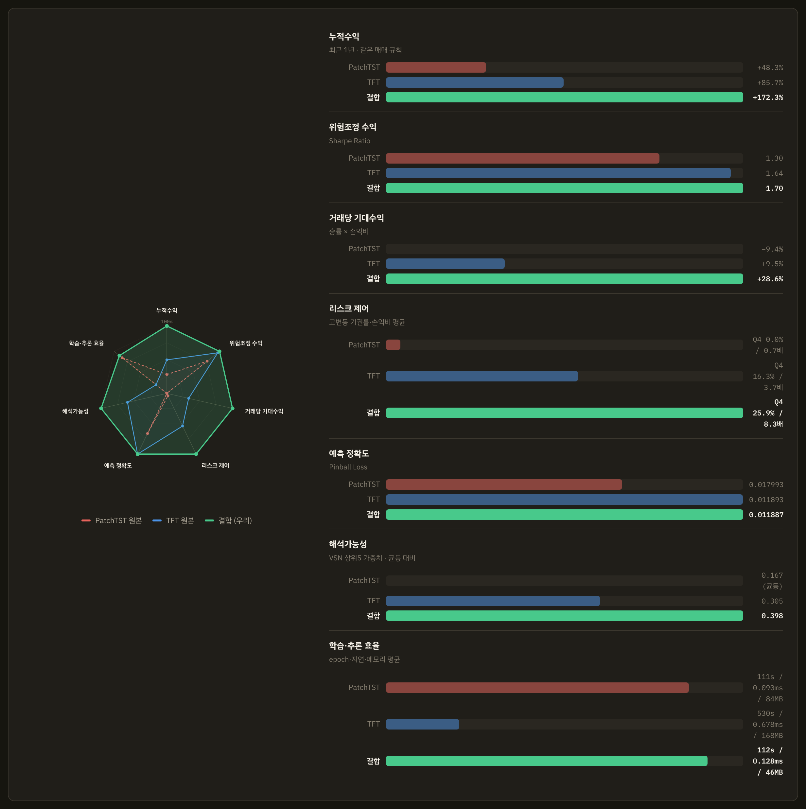
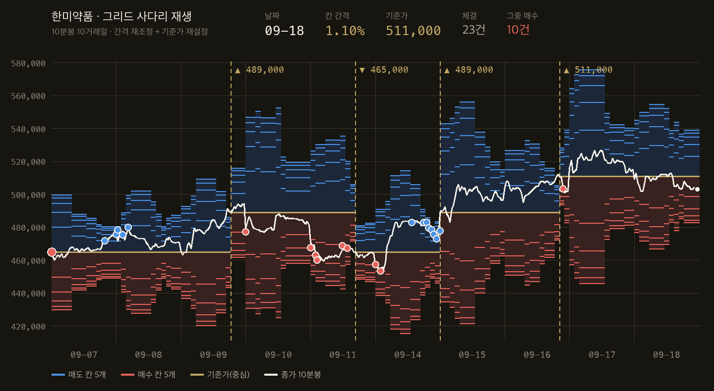
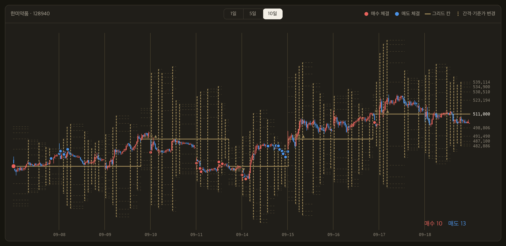

# Cheaper Quantiles, Same Accuracy

### Recombining PatchTST and TFT for Interpretable Stock Return Forecasting

**Park Sungjun, Kim Jimin, Kwon Ohjae, Song Haeol**
*Park Sungjun, first author; Kim Jimin, Kwon Ohjae and Song Haeol, co-authors.*

**Repository:** `Capstone_Stock_Price_Prediction` · **Model under study:** `phase1_eadf265f`
**Date:** 2026-10-12 · **Hardware:** Apple MPS (local) / Kaggle CUDA (training)

> Every number in this paper is transcribed from scripts and artifacts inside the
> repository (`outputs/reports/`). Reproduction commands accompany each table and the
> full procedure is in Appendix A. **All live trading is on a Kiwoom paper (`mock`)
> account; no real-money results are reported.**

---

## Abstract

Patch-based time-series transformers (PatchTST) tokenize a series in segments and keep
channels independent, which makes long lookbacks cheap — but they emit point forecasts
and never say which variable they used. The Temporal Fusion Transformer (TFT) fixes both
through a Variable Selection Network (VSN) and a quantile head, but pays for it by
attending at every time step. We take parts from both lineages and reassemble them into a
**0.50M-parameter model: a PatchTST backbone, TFT variable selection and quantile head,
and a macro cross-attention block of our own**, then compare it against both originals
under one controlled protocol — identical panel, split, seed, training loop, trading
rules and backtest window.

Forecast accuracy is **+2.36%** against an unconditional-quantile baseline, statistically
indistinguishable from the original TFT (+2.32%) and far ahead of the original PatchTST
(point forecast, −47.79%). **What separates the tie is cost**: on the same Apple MPS
device the TFT needs 529.5 s/epoch against 111.5 s for our model (4.7×), 0.678 ms vs
0.128 ms per-stock inference (5.3×), and 167.8 MB vs 45.8 MB of activation memory
(3.7×). Over an identical 12-month backtest our model returns +172.3% (Sharpe 2.19)
versus TFT +85.7% (1.77) and PatchTST +48.3% (1.06), with the KOSPI 200 at +124.2% (1.71).
Abstention behaves as designed: our model declines 25.9% of the highest-volatility
quartile but only 0.45% of the lowest, and its realized payoff ratio is 8.3× against
TFT's 3.7× and PatchTST's 0.67×.

We report with equal weight what the architecture does **not** buy. Rank correlation
between learned VSN importance and univariate predictive power is **−0.03**; the
"dynamic" variable selection is effectively frozen (year-over-year rank agreement
0.988–0.995, bootstrap rank s.d. 0.00). Directional information coefficient is 0.024
(t = 3.9) while the interval-width IC is 0.294 (t = 43.8) — **12× larger**. A permutation
test attributes only Sharpe +0.12 (p = 0.25) to the ranking signal. The honest reading is
that the recombination buys **the same quantile accuracy at a quarter of the cost, with
learned feature weights attached** — and that the model's real competence is uncertainty,
not direction.

**Keywords:** time-series transformer, quantile regression, variable selection network,
interpretability, cross-attention, forecast uncertainty, abstention, stock return forecasting

---

## 1. Introduction

### 1.1 Motivation — "we used a recent model" explains nothing

Deep-learning work on stock prediction usually does one of two things: port a recent
architecture onto a new dataset, or tune losses and hyperparameters until a metric moves.
Neither answers **why this architecture**. When structure is not derived from
requirements, the model becomes an interchangeable part, and no outcome — good or bad —
can be explained afterwards.

This project started from two operational requirements, not from a model.

1. **Abstention.** Saying "up or down" is not enough; the system must also say
   *"should a decision be made at all right now?"*. That cannot be defined on a point
   estimate. A predictive **distribution** is required before "the interval is too wide,
   so hold" becomes expressible.
2. **Interpretability.** A trade needs a human-readable basis. Post-hoc attribution
   (e.g. SHAP) explains a surrogate of the model, not the model's own computation. For the
   weight to count as evidence it must exist **as a learned parameter**.

These two requirements force the architecture. (1) demands a quantile head with a pinball
loss; (2) demands learned variable importance, i.e. the TFT Variable Selection Network.
Using TFT as-is makes cost the binding constraint (§5.2); using PatchTST as-is provides
neither. **Recombination is therefore not the goal but the consequence** — and that is the
claim this paper defends.

### 1.2 Research questions

| # | Question | Answered in |
|---|---|---|
| Q1 | Does the recombined structure beat each original, and *on which axis*? | §5.2, §5.3 |
| Q2 | Do the integration choices (VSN placement, macro injection direction, quantile monotonicity, head initialization) measurably matter? | §3.4–3.6, §5.1 |
| Q3 | Can learned variable importance be presented as a trading rationale? | §5.4, §7.2 |
| Q4 | Is backtest performance attributable to the model's signal? | §5.6, §7.3 |

The answer to Q4 is negative, and we state it up front. The negative result is kept in
§5.6 and §7.3 rather than omitted, because without it the return table in §5.3 invites
exactly the over-reading this paper is trying to avoid.

### 1.3 Contributions

1. **A requirement-derived recombination.** PatchTST's channel independence is retained
   **not for efficiency but to keep something for the VSN to weight** (§3.3). That is the
   actual graft point between the two lineages, and the reasoning is recorded in the
   source itself.
2. **A four-model comparison under one protocol.** Original PatchTST (point), PatchTST +
   quantile head, original TFT, and the proposed model share panel, split, seed, training
   loop, trading rules and backtest window. That the unconditional baseline loss comes out
   as **0.012175 for all four** is numerical evidence that the control actually held (§5.2).
3. **Costed design decisions.** Placing the VSN before the encoder changes a forward pass
   from 259 ms to 52 ms (5×); merging macro channels before encoding saves 13×. These are
   the numbers architecture papers usually omit.
4. **Self-refutation of the interpretability claim.** We contrast VSN importance with
   univariate IC (rank correlation −0.03) and show by bootstrap that the selection is
   effectively static (§5.4), separating *"we expose importance weights"* from
   *"those weights mean predictive power"*.
5. **Full attribution accounting.** Permutation test (p = 0.25), decile spread at 1/6 of
   round-trip cost, and the disappearance of directional IC once look-ahead is removed are
   all reported.

---

## 2. Related Work

> ⚠️ **Bibliographic caveat.** Several entries in §2.1–2.5 have not yet been verified
> against the original PDFs (the same warning appears in `docs/REFERENCES.md`). They must
> be checked before submission. The grid-trading references in §6 *were* verified against
> the source PDFs.

### 2.1 Patch-based time-series transformers

Nie et al. (PatchTST, ICLR 2023) tokenize a series in **segments (patches)** rather than
per time step, and process multivariate input with **channel independence**. A length-$L$
sequence collapses to $\lceil L/S \rceil$ tokens, cutting attention cost, and the model
scales linearly in channel count. We cut a 120-day lookback with patch length 5 (one
trading week) and stride 5, giving **24 tokens**.

Two deficits follow. (a) The output is a point forecast, so there is no uncertainty; and
(b) the model never reports which channel mattered. Our two requirements map exactly onto
these two deficits.

### 2.2 Interpretable forecasting — TFT

Lim et al. (Temporal Fusion Transformer, *Int. J. Forecasting*, 2021) learn a softmax gate
over input channels in a **Variable Selection Network**, transform each channel through a
**Gated Residual Network (GRN)**, and emit several **quantiles** at once. Static covariates
are encoded separately and injected as a context vector.

TFT is a 2021 model and is not state of the art. We keep its parts for **function, not
recency**: no later component replaces "learn variable importance as a gate." What we
discard is the per-time-step recurrent/attention stack — §5.2 prices that choice.

### 2.3 Normalizing distribution shift — RevIN

Kim et al. (RevIN, ICLR 2022) apply instance normalization per input window and invert it
at the output. With price data, where level means different things across stocks and
across decades, this is not optional.

We apply RevIN **selectively**. Cross-sectional rank channels (`xs_*`) carry their
information entirely in the level — "where does this stock rank today" — and RevIN,
standardizing within a stock's own window, erases exactly that. The exception is managed
by `features.cross_sectional` in `configs/config.yaml`.

### 2.4 Quantile regression and the pinball loss

Applying Koenker & Bassett (*Econometrica*, 1978) quantile regression to a network output
gives the pinball loss; for quantile $\tau$,

$$\mathcal{L}_\tau(y, \hat{y}) = \max\big(\tau (y - \hat{y}),\ (\tau - 1)(y - \hat{y})\big),$$

trained jointly over $\tau \in \{0.1, 0.5, 0.9\}$. A quantile forecast delivers uncertainty
**as the prediction itself**, so an abstention rule needs neither post-hoc calibration nor
an ensemble variance. That was the shortest path to requirement (1).

### 2.5 Exogenous injection and TimeXer — an independent arrival, stated

Our cross-attention module (`src/models/cross_attention.py`) was not taken from a paper.
We chose to make domestic stock sequences the Query and macro/global index sequences the
Key/Value. **However, "inject exogenous variables through attention" is not a new idea,
and TimeXer (2024) addresses the same problem in print.** We did not build on TimeXer; we
arrived at the same place independently. Stating this alongside the claim is, in our view,
the honest form of the contribution.

### 2.6 Baseline literature — trees often win

On the public Qlib benchmark (CSI300/Alpha158), LightGBM and XGBoost outperform both
Transformer and LSTM baselines (Rank IC 0.047–0.051 vs 0.041–0.044). "No fair comparison
against a well-tuned simple baseline" is the standing weakness of this literature. We ran
a GBDT baseline under the same protocol to answer it (§5.6).

### 2.7 Considered and not used

| Alternative | Why not |
|---|---|
| DLinear / TSMixer (2022–23) | Can be modified to emit three quantiles, but offer **no learned variable importance** — requirement (2) fails |
| Time-series foundation models (Chronos, TimesFM, Moirai) | Effective independent events number ~1,900 trading days; fine-tuning does not reach scale. Even 0.33M parameters overfit this data (§5.1) |
| Mamba / SSM parallel experts | Deferred, not rejected. `mamba-ssm` is CUDA-only, so the development machine (Mac/MPS) would need a pure-PyTorch reimplementation |

---

## 3. Method

### 3.1 From requirements to parts

| Requirement | Property it forces | Part chosen |
|---|---|---|
| Abstention: "may I decide now?" | A **distribution**, not a point. $q_{90}-q_{10}$ must exist | Quantile head + pinball loss |
| Interpretability: trade rationale | **Learned** importance, not a post-hoc surrogate | TFT VSN + GRN |
| Scale differs by stock and by era | Non-stationary normalization | RevIN (with channel exceptions) |
| Lookback 120 × 201 stocks | Sequence-length reduction | Patch tokenization (120 → 24) |
| Korean equities track global macro | Exogenous sequence injection | Cross-attention (our design) |

**No part was selected because it was recent.** Each left-hand entry forces its right-hand one.

### 3.2 Architecture


**Figure 1.** (a) Full model. Yellow = PatchTST lineage, blue = TFT components, teal =
macro cross-attention (our addition), orange = static context path. (b)–(e) detail the
encoder layer, the Gated Residual Network, the Variable Selection Network, and the
monotone quantile head. $C = 30$ stock channels, $M = 13$ macro channels, $L = 120$ days,
$P = 5$, $N = 24$ patches, $D = 32$.

Input arrives on three paths: dynamic stock features
$X \in \mathbb{R}^{B \times L \times C}$ ($L = 120$, $C = 30$), macro sequences
$M \in \mathbb{R}^{B \times L \times C_m}$ ($C_m = 13$), and three static categoricals $s$.
Static embeddings form a context vector $c_s$ that conditions variable selection; after
cross-attention the same context is added back as static enrichment; and only the **last
patch token** $h_N$ (the most recent week) is passed to the head.

The decisive ordering is that **the VSN sits before the encoder**, which is the original
TFT order and reverses our own first design (encoder → cross-attention → VSN); §3.4 gives
the measurement that forced the reversal.

### 3.3 RevIN and patching — the real reason channels stay independent

Patch embedding turns each channel independently into $\lceil 120/5 \rceil = 24$ tokens.
This looks like PatchTST's channel independence carried over verbatim, but our reason is
not efficiency. The comment in `src/models/patch_embed.py` states it directly:
**mixing channels destroys the object the TFT variable selection network is supposed to
weight, and with it the basis for interpretability.**

In other words, channel mixing would leave the VSN of §3.5 undefined. This is where the two
requirements collide, and interpretability won. It is the actual graft point between the
two lineages.

### 3.4 Design decision 1 — put the VSN *before* the encoder (5×)

The VSN applies a softmax gate across the channel axis:

$$\alpha = \mathrm{softmax}\big(\mathrm{GRN}_{\alpha}([\,\mathrm{flat}(E)\,;\,c_s\,])\big)
\in \mathbb{R}^{C}, \qquad
Z = \sum_{i=1}^{C} \alpha_i \cdot \mathrm{GRN}_i(E_i),$$

with $E_i$ the patch embedding of channel $i$. Why ordering decides performance:

- **VSN after the encoder** — the encoder still sees a channel axis and therefore runs
  **once per channel**. Measured forward pass at the then-current 17 channels: **259 ms**.
- **VSN before the encoder** — channels are already collapsed to one, so the encoder runs
  **once**. Same conditions: **52 ms** — a **5× difference**.

Interpretability survives intact: the VSN consumes patch embeddings and weights channels,
so $\alpha$ still answers "which channel was used, how much." The ordering is pinned by the
regression test `tests/test_models.py::test_encoder_runs_once_not_per_channel`.

Separately, running 17–30 per-channel GRNs in a Python loop launches one kernel per channel
and starves the GPU; `GroupedGRN` folds them into a single einsum.

### 3.5 Design decision 2 — the *direction* of macro cross-attention

The stock representation $Z \in \mathbb{R}^{B \times 24 \times d}$ is the Query, the macro
encoding the Key/Value:

$$\mathrm{CA}(Z, H_m) = \mathrm{softmax}\!\left(\frac{(Z W_Q)(H_m W_K)^{\top}}{\sqrt{d_k}}\right)(H_m W_V).$$

**Direction is the design.** With macro as Query the output takes the shape of the macro
sequence and per-stock forecasts disappear (`cross_attention.py:6` records the same point).

We deliberately gave the macro path no VSN. Macro channel importance is not an object of
interpretation here, and encoding macro per channel costs **13×**. Macro channels are
therefore merged first and encoded once. The asymmetry is intentional: the VSN goes only
where explanation is required.

### 3.6 Design decisions 3 and 4 — monotone quantiles and baseline initialization

**(3) Monotonicity is structural, not a penalty.**

$$q_{10} = o_1, \qquad q_{50} = q_{10} + \mathrm{softplus}(o_2), \qquad
q_{90} = q_{50} + \mathrm{softplus}(o_3).$$

Cumulative softplus makes quantile crossing **impossible by construction**; the crossing
penalty (`crossing_weight = 0.01`) is kept only as a secondary term. The reason is
operational: a crossing makes the abstention width $q_{90}-q_{10}$ negative, and
`QuantilePrediction` in `src/trading/signal.py` raises, killing the entire backtest. A loss
penalty alone leaves residual crossings. Measured crossing rate for all four models in
§5.2 is **0.000**.

**(4) Start the head at the unconditional quantiles.** With default initialization
$\mathrm{softplus}(0) = 0.693$, so the initial inter-quantile gap is 0.69 while the full
quantile span of a 5-day return is 0.124 — **the output starts 9× larger than the target**.

| Head initialization | val pinball | vs baseline (0.013285) |
|---|---|---|
| Default | 0.013993 | **−5.3%** (worse than predicting a constant) |
| Bias set to training unconditional quantiles | — | leads to the positive margins in §5.1–5.2 |

The model spent its entire budget shrinking scale before it could learn signal. The fix
sets the final-layer bias to the baseline quantiles (increments through inverse softplus)
and the final-layer weight to $\mathrm{std} = 10^{-4}$. **The weight must not be exactly
zero**: $\partial o/\partial z = W = 0$ stops gradient from reaching the encoder at all
(verified empirically).

### 3.7 Final hyperparameters

| Item | Value | Source |
|---|---|---|
| lookback / patch / stride | 120 / 5 / 5 → 24 tokens | 5 trading days = 1 week |
| $d_{model}$ / heads / layers / $d_{ff}$ | 32 / 2 / 1 / 64 | sweep, §5.1 |
| dropout (encoder, cross-attn, VSN) | 0.5 | §5.1; caveat in §7.3 |
| VSN hidden | 64 | — |
| Quantiles | (0.1, 0.5, 0.9) | minimum that defines abstention |
| Dynamic / macro / static | 30 ch. / 13 ch. / 3 (vocab 23, 6, 6) | §4.2 |
| Parameters | **0.50M** | §5.1 |

---

## 4. Data and Experimental Setup

### 4.1 Data

| Item | Detail |
|---|---|
| Source | Kiwoom Securities REST API (daily `ka10081`, index `ka20006`, investor flow `ka10059`, stock info `ka10001`) |
| Universe | **201 KOSPI 200 constituents** (`configs/universe.yaml`) |
| Period | 2015-01-01 onward (up to 2,857 trading days per stock) |
| Panel | 416,386 rows × 37 columns (`data/processed/panel_idxrel2.parquet`) |
| Storage | `data/raw/{kind}/{code}.parquet`; collection is incremental and idempotent |

**Cleaning.** Trading-halt days arrive as `volume = 0` with `open = high = low = close`
(previous close). Left in, they produce fake zero returns, understated volatility, and
distorted ATR/RSI, so they are dropped **before** indicator computation. Stocks have
different trading calendars (1,887 common days vs 2,857 total), so forcing a common
calendar would discard 34% of the data; windows are built on each stock's own rows.

### 4.2 Features

**30 dynamic channels**, all computable from information available at time $t$.

| Group | Channels |
|---|---|
| Return / momentum | `ret_1d` `ret_5d` `ret_20d` `mom_12_1` `rev_1m` |
| Trading activity | `turnover_z` `rvol_20` `vol_ratio` `vol_zscore` |
| Moving-average gaps | `ma5_ratio` `ma20_ratio` `ma60_ratio` |
| Technical indicators | `macd` `macd_signal` `macd_hist` `rsi` `cci` `bb_pctb` `bb_width` `atr` |
| Index-relative | `rs_20` `rs_60` `beta_120` + cross-sectional ranks `xs_rs_20` `xs_rs_60` `xs_beta_120` |
| Investor flow | `flow_individual` `flow_foreign` `flow_institution` `flow_pension` |

**13 macro channels** — KOSPI/KOSDAQ index derivatives and a domestically listed overseas
index ETF. KODEX US Semiconductor MV (390390) listed on 2021-06-30, so its earlier span is
masked rather than dropped.

**3 static categoricals** — `sector` (vocab 23), `market_cap_bucket` (6), `day_of_week` (6).

**Scaling rules.** Raw price levels are meaningless across eras ("70,000 KRW" in 2015 is
not 2026's 70,000). Moving averages become gaps to close, MACD and ATR are divided by
close, RSI and CCI are compressed to [0, 1].

**Look-ahead control.** Neither `center=True` nor `shift(-n)` appears in `technical.py`.
The only forward-looking function is the label generator `forward_log_return()`, which is
never placed in the feature list. The regression test
`tests/test_technical.py::test_no_lookahead` multiplies future closes by 3 and asserts that
no past indicator value moves.

⚠️ **PER/PBR are excluded.** The API returns a single snapshot row, not a history; used as
a time-$t$ feature it would be look-ahead. The columns exist in `static.parquet` but are
not model inputs.

⚠️ **`market_cap_bucket` is cut at `train_end`.** Cutting it at query time would let a 2015
row know that the stock grows later. We roll the value back by the adjusted-price ratio,
$\text{mcap}(T) = \text{mcap}(\text{now}) \times P_T / P_{\text{now}}$, so the future term
cancels. Before and after the fix, **106 of 201 stocks (56%) changed bucket** — not a
harmless difference. `size_class` was removed from the inputs entirely because no
historical value is obtainable.

### 4.3 Target

$$y_t = \sum_{k=1}^{5} r_{t+k} \;-\; \sum_{k=1}^{5} r^{\text{KOSPI200}}_{t+k}$$

the 5-day cumulative log return **in excess of KOSPI 200**. Auxiliary horizons of 1, 2 and
3 days are learned from the same window as a multi-task regularizer.

Aligning the target to excess return was not a free choice but an ablation result (§5.7):
with a raw-return target, test rank IC was −0.0018 (t = −0.18) — no information in the
cross-sectional ordering at all.

### 4.4 Split, embargo, normalization

| Split | Period | Samples (at the 146-stock stage) |
|---|---|---|
| train | through 2022-12-31 | 260,339 |
| val | 2023-01-01 – 2023-12-31 | 17,584 |
| test | 2024-01-01 onward | 74,953 |

- **Global split by date**, never by stock.
- **Normalization statistics are estimated on train only.** Including val/test in the
  statistics is theft from the future.
- **5-day embargo at each boundary.** The label looks to $t+5$, so cutting without an
  embargo lets the last training sample read into validation. Training refuses to start if
  `aux_horizons` exceeds the embargo.

**Nominal sample counts are not independent information** — this is what set the model size.

| Measure | Value |
|---|---|
| Input overlap between adjacent samples | **99.2%** (119 of 120 lookback days shared) |
| Target overlap | 4 of the 5 days $t+1 \dots t+5$ |
| Approximate non-overlapping samples | 52,097 (20% of nominal) |
| **Effective independent events** | **~1,900 trading days** — 201 stocks on one date share a market factor |

### 4.5 Baseline — unconditional quantiles

Every experiment is scored against the **unconditional quantiles of the training data**: a
predictor that ignores its input and emits three constants. `train.py` recomputes it on
every run and writes it into the report.

This baseline is the project's real reference point. **Failing to beat it is treated as a
feature/target design failure, not a hyperparameter problem.** In §5.2, the fact that all
four architectures report the identical baseline loss is the evidence that the control held.

### 4.6 Metrics

| Metric | Definition | What it measures |
|---|---|---|
| val pinball | §2.4 loss averaged over three quantiles | distributional quality — mostly **width** |
| Rank IC | daily $\mathrm{corr}(\mathrm{rank}(q_{50}), \mathrm{rank}(y))$, averaged, with t-stat | **direction** |
| Width IC | $\mathrm{corr}(q_{90}-q_{10},\ \text{realized volatility})$ | **uncertainty** |
| Interval coverage | $P(q_{10} \le y \le q_{90})$, nominal 80% | calibration |
| Decile spread | top 10% minus bottom 10% return | does the signal clear costs |
| Sharpe / MDD / CAGR | shared `src/evaluation/metrics.py` | trading outcome |

**Backtest and paper trading call the same metric functions**, which is what makes
"backtest Sharpe vs live Sharpe" a legitimate comparison. Inference is likewise a single
path, `src/models/inference.py`.

### 4.7 From forecast to order

The rule that converts quantiles into trades. In the architecture comparison (§5.3) all
four models are run through **this same rule and the same cost assumptions**.

```
1. Abstain : if q90 − q10 exceeds a threshold (a percentile of the recent width
             distribution), do not trade this name
2. Direct  : among survivors, rank by q50 cross-sectionally, buy the top N
             · hysteresis buffer: an existing holding is sold only when it falls
               outside exit_rank
3. Size    : narrower interval (higher confidence) gets more weight — not equal weight
4. Overlay : per-name weight cap, stop-loss, daily trade cap
             (a portfolio CVaR limit was tested and rejected, §7.3)
5. Send    : Kiwoom paper-trading endpoint; dry-run by default
```

**The abstention threshold is a percentile, not an absolute level, and that came from a
failure.** Under an absolute threshold, training ending in the 2022 drawdown left the
model's median forecast (−0.15%) below the realized mean (+0.80%), so the buy threshold
(+0.40%) was **structurally unreachable**: 64 fills in 2.1 years at 8.9% average exposure.
The strategy had not lost; it had not participated. Switching to cross-sectional ranking
moved fills from 64 to 1,247, exposure from 8.9% to 66.5%, and Sharpe from 0.14 to 0.88.

The same failure mode recurs once more in §7.3 with an absolute CVaR limit.
**A level that does not transfer across regimes is not a gate; it is a constant.**

---

## 5. Results

### 5.1 Model size — smaller is better

Because effective independent events number about 1,900 (§4.4), capacity was swept before
anything else (146 stocks, full training run, 2026-08-25).

| Preset | Parameters | best val pinball | vs baseline | best epoch |
|---|---|---|---|---|
| current | 1.88M | 0.014177 | +0.51% | 1 ← overfits immediately |
| tiny | 0.49M | 0.013799 | +3.16% | 1 |
| small | 0.67M | 0.013782 | +3.28% | 1 |
| **minimal** | **0.33M** | **0.013772** | **+3.35%** | **3** ← only configuration without overfitting |

The 1.88M model's best epoch was epoch 1 (still inside LR warmup at 6e-5); from epoch 2 its
validation loss was worse than the constant baseline while training loss kept falling from
0.0132 to 0.0110 — textbook immediate overfitting. **A best epoch of 1 is itself a symptom**,
which is why `tiny` and `small` were rejected despite respectable margins.

**Statistical significance.** The 0.000478 improvement tested by date-level block bootstrap
is **2.8σ**. Assuming i.i.d. samples would give 5.5σ, but same-day stocks share a market
factor, so the block figure is the correct one. We report 2.8σ.

The deployed model is 0.50M rather than 0.33M because the universe grew to 201 stocks and
the dynamic channel count grew from 17 to 30 (§5.7); the shape settings
($d_{model}=32$, 1 layer, dropout 0.5) are unchanged from the sweep winner.

⚠️ Validation covers only calendar 2023, a single regime. §5.3 and §7 treat this as a
standing caveat rather than a solved problem.

*Reproduce:* `python scripts/sweep.py`

### 5.2 Four architectures, one protocol

All four were trained on the same panel, split, seed, training loop and early-stopping rule.
**The unconditional baseline came out at 0.012175 for all four**, which is the numerical
proof that the control held.

**(a) Forecast accuracy** — validation, three-quantile pinball:

| Model | Params | val pinball | vs baseline | best epoch | per-quantile [q10, q50, q90] | crossings |
|---|---|---|---|---|---|---|
| PatchTST, original (MSE, point) | 0.034M | 0.017993 | **−47.79%** | 1 | .01789 / .01799 / .01810 | 0.000 |
| PatchTST + quantile head | 0.035M | 0.012143 | +0.26% | 5 | .00835 / .01799 / .01009 | 0.000 |
| TFT, original | 0.687M | 0.011893 | +2.32% | 2 | .00801 / .01797 / .00969 | 0.000 |
| **Ours (PatchTST × TFT)** | **0.500M** | **0.011887** | **+2.36%** | 5 | .00804 / .01793 / .00970 | 0.000 |

Three readings follow.

1. **A point-forecast backbone is not merely worse; it is unusable for this task.** The
   original PatchTST scores −47.79% against a constant predictor, because an MSE-trained
   point forecast evaluated by pinball is a degenerate distribution ($q_{10}=q_{50}=q_{90}$,
   visible in its flat per-quantile column). This is not a criticism of PatchTST — it is the
   quantitative statement of requirement (1): **without a distribution, abstention is undefined.**
2. **Attaching a quantile head is necessary but not sufficient.** PatchTST + quantile head
   recovers to +0.26% — barely above a constant. The missing ingredients are variable
   selection, static context and macro input, i.e. precisely the TFT-side parts.
3. **TFT and our model are tied on accuracy** (+2.32% vs +2.36%; per-quantile losses agree to
   the fourth decimal). **This is the central empirical fact of the paper, and we do not
   claim a win here.** The tie is broken in (b).

**(b) Cost** — Apple MPS, batch 64, 201-stock universe:

| Model | s/epoch | latency per stock | full-universe pass | activation @ L=120 | parameter memory |
|---|---|---|---|---|---|
| PatchTST (+quantile head) | 111.1 (111.5) | 0.090 ms | 18.0 ms | 84.0 MB | 0.14 MB |
| TFT, original | **529.5** | **0.678 ms** | 136.2 ms | 167.8 MB | 2.75 MB |
| **Ours** | **111.5** † | **0.128 ms** | 25.7 ms | **45.8 MB** | 2.00 MB |

† Our model trained on Kaggle CUDA at **29.3 s/epoch**; the MPS figure is a measured proxy so
that all three columns sit on one device. Epoch times are **medians** — a laptop that sleeps
mid-epoch inflates the mean by up to 7×, which happened and was blocked with
`caffeinate -i -m -s -w <pid>`.

**This is what the recombination buys.** At identical accuracy, our model trains **4.7×
faster**, infers **5.3× faster per stock**, and holds **3.7× less activation memory** than
the TFT. Activation scaling is linear in lookback for both (ratio ≈ 3.96 from L=60 to L=240),
so the gap is structural, not a constant offset: patch tokenization removes a factor of
$P = 5$ from the attended sequence, and the single-pass encoder (§3.4) removes the channel
loop. The 1.4× parameter advantage is secondary — **the real saving is in activations and
wall-clock, which is what decides whether a daily retrain fits in a student's compute budget.**

*Reproduce:* `python scripts/arch_compare.py` → `outputs/reports/arch_compare_*.json`

### 5.3 Trading outcome under one rule set



**Figure 2.** Seven-axis comparison of the two originals and the recombined model (radar at
left; per-axis detail at right). The composite ordering is consistent across every axis, but
note that the *risk-adjusted return* and *risk control* rows are computed on the round-trip
basis of Table (d), while Table (c) below reports the daily portfolio curve — see the
reconciliation note.

**(c) Backtest**, 2025-09-16 → 2026-09-16, 244 trading days, identical trading rules, costs
and rebalancing for all four models:

| Model | Total | CAGR | Volatility | Sharpe | MDD | Calmar | Hit | Fills | Turnover |
|---|---|---|---|---|---|---|---|---|---|
| PatchTST, original | +48.3% | 50.2% | 50.0% | 1.063 | −36.2% | 1.385 | 58.4% | 110 | 4.11 |
| PatchTST + quantile | +55.4% | 57.6% | 48.6% | 1.178 | −32.9% | 1.749 | 58.9% | 146 | 5.80 |
| TFT, original | +85.7% | 89.5% | 41.1% | 1.765 | −24.4% | 3.664 | 58.9% | 123 | 4.59 |
| **Ours** | **+172.3%** | **181.4%** | 54.2% | **2.185** | −33.6% | **5.401** | **62.1%** | 142 | 4.65 |
| *KOSPI 200* | *+124.2%* | *130.2%* | *59.1%* | *1.707* | *−40.9%* | *3.180* | *62.8%* | — | — |

**(d) Abstention and round-trip economics** — the same runs, measured per completed round trip:

| Model | Abstain (all) | Q1 | Q2 | Q3 | **Q4** | Round trips | Win rate | Avg win | Avg loss | **Payoff** | Expectancy |
|---|---|---|---|---|---|---|---|---|---|---|---|
| PatchTST, original | 0.0% | 0.0 | 0.0 | 0.0 | **0.0%** | 23 | 13.0% | +7.96% | −11.95% | 0.67× | −9.35% |
| PatchTST + quantile | 4.72% | 0.44 | 2.05 | 4.32 | **12.07%** | 32 | 37.5% | +30.3% | −12.4% | 2.44× | +3.62% |
| TFT, original | 5.80% | 0.0 | 0.73 | 6.20 | **16.28%** | 41 | 36.6% | +48.9% | −13.2% | 3.70× | +9.51% |
| **Ours** | **7.91%** | 0.45 | 0.79 | 4.52 | **25.88%** | 46 | 34.8% | +106.5% | −12.86% | **8.28×** | **+28.6%** |

Q1–Q4 are realized-volatility quartiles of the candidate at decision time.

**This table is the paper's most direct evidence that the abstention requirement was met by
the architecture rather than by the trading rule.** The rule is identical across rows; only
the forecast distribution differs. The point-forecast model abstains on nothing because it
has no width to threshold — its payoff ratio is below 1 and its expectancy is negative, i.e.
it loses more per loss than it gains per win. Adding a quantile head alone lifts expectancy
to positive. Adding variable selection, static context and macro input pushes Q4 abstention
to **25.9%** while Q1 abstention stays at **0.45%** — the model declines 57× more often in
the most volatile quartile than in the calmest, and the resulting payoff ratio is 8.3×.
**Win rate does not improve** (34.8%, the lowest of the three quantile models); the entire
gain is in the size asymmetry between wins and losses, which is exactly what one should
expect if the model is pricing uncertainty rather than calling direction.

**Reconciliation note (important).** Figure 2's *risk-adjusted return* row reads
1.30 / 1.64 / 1.70, while Table (c) reads 1.063 / 1.765 / 2.185 for the same runs. The former
is the round-trip Sharpe of Table (d) (23/41/46 completed trades), the latter the daily
portfolio-curve Sharpe. The ordering agrees under the round-trip measure
(PatchTST < TFT < ours) and under Calmar and total return; it differs for TFT vs PatchTST on
the daily curve. **We report both rather than picking the flattering one, and recommend that
presentations fix one basis and state it.**

⚠️ **Do not read the +172.3% as a repeatable edge.** Three constraints apply simultaneously.
(i) The window is one calendar slice of a historic bull market; shifting the start date by a
few days moves the same strategy's 6-month result between −9.4% and +10.3%.
(ii) A separate 10-slice calendar study of the production configuration shows 9/10 slices
beating the index over 2 years and 8/10 over 1 year, but only 3/10 over 6 months — and that
configuration was **selected on test**, because validation (2023) is a flat +4.3% year in
which every configuration clusters within 1.2 percentage points and therefore cannot
discriminate. (iii) §5.6 shows the ranking signal is not statistically attributable.
The defensible claim from Table (c) is **relative**: under one rule set and one window, the
recombined model dominated both originals on every return and risk-adjusted measure.

### 5.4 Does variable selection actually select?

**(e) Top-5 learned importance per model:**

| Model | Top-5 channels (weight) | Top-5 mass |
|---|---|---|
| PatchTST (+quantile) | `ret_1d` `ret_5d` `ret_20d` `mom_12_1` `rev_1m`, each 0.0333 | 0.167 (uniform — no selection exists) |
| TFT, original | `atr` 0.092 · `kospi_ret_5d` 0.082 · `kospi_vol_ratio` 0.046 · `kospi_ret_1d` 0.044 · `flow_pension` 0.042 | 0.305 |
| **Ours** | `vol_zscore` 0.117 · `bb_width` 0.105 · `turnover_z` 0.075 · `vol_ratio` 0.052 · `flow_individual` 0.051 | **0.398** |

Uniform mass over 30 channels is 0.167 by construction, so the PatchTST row is a floor, not a
measurement. Both VSN-bearing models concentrate well above it, and ours concentrates
**2.4× above uniform**. The composition is also informative: the TFT spends three of its top
five on macro channels it receives as concatenated observed inputs, while our model — which
reaches macro through a separate cross-attention path — spends its top five on stock-level
volatility and activity channels. **Separating the macro path changes what the selector
selects**, which is the intended consequence of §3.5.

**Now the self-refutation.** Concentration is not correctness. Measured on 75,975 test
windows with `scripts/feature_diagnostics.py`:

| | VSN rank | train univariate \|IC\| rank |
|---|---|---|
| `atr` | **1** | 13 |
| `vol_ratio` | **2** | 14 |
| `vol_zscore` | 5 | 17 (last) |
| `ma5_ratio` | 7 | **1** |
| `ret_20d` | 17 (last) | 10 |

Rank correlation: **−0.03** — essentially unrelated.

This must not be read as "the VSN is wrong." A VSN weight is **the share a channel receives
in building the representation**, not its contribution to directional prediction. That the
top five are all volatility and volume channels is consistent with §5.5: the model's output
is mostly *width*, and width is a volatility forecast. **The correct limitation statement is
that importance weights read as "this feature predicts returns" but do not mean that, so we
publish them next to univariate IC rather than alone.**

**And the "dynamic" selection is effectively static:**

| Measure | Value | Reading |
|---|---|---|
| Per-window rank ↔ global mean rank | **0.966** | different samples, nearly the same order |
| Date-bootstrap rank s.d. (300 draws) | **0.00** (all channels) | does not move |
| Year-over-year rank agreement (2024/2025/2026) | **0.988 – 0.995** | regime change does not move it |

Stability is a virtue for reproducibility, but **the sentence "the model looks at different
variables in different situations" cannot be written.** This model's variable selection is
close to one learned global weight vector. Static covariates likewise barely use sector
(`size_class` 0.44 / `market_cap_bucket` 0.34 / `day_of_week` 0.16 / **`sector` 0.06**) — the
hand-entered sector labels earn little relative to their cost.

### 5.5 Calibration, and what the model is actually good at

| Measure | Result |
|---|---|
| Interval coverage, nominal 80% | **78.6%** measured |
| CQR conformal correction | **+0.024** — correction is near-negligible |
| **Directional IC** (q50 vs realized return) | **0.024** (t = 3.9) |
| **Width IC** (q90−q10 vs realized volatility) | **0.294** (t = 43.8) |

**The ability to forecast width exceeds the ability to forecast direction by a factor of 12.**
Three independent measurements — permutation test (§5.6), VSN composition (§5.4), and this
pair of ICs — point to the same conclusion. Combined with Table (d), where all of the
performance separation appears in payoff asymmetry rather than win rate, the honest statement
of this model's competence is **"it knows when not to decide," not "it picks winners."**
The design that made abstention a first-class requirement turned out to match the model's
actual ability — which was luck as much as foresight, and we say so.

*Reproduce:* `python scripts/coverage.py`

### 5.6 Negative results — baseline and attribution

**(a) Against GBDT.** Same panel, same date split, same embargo, same target, same evaluation
functions, same backtest and trading configuration, same `(code, date)` intersection (Phase 1
cannot predict until 120 days of lookback exist), and date-based early stopping for both
(scikit-learn's internal split randomizes and stops optimistically on autocorrelated rows).
The tree sees time-$t$ features plus lags 1/5/20 — 85 features, 274,939 training rows — since
trees cannot ingest sequences; Alpha158 folds lookback the same way.

| test, 518 days | Rank IC | t | Decile spread |
|---|---|---|---|
| **Phase 1 transformer** | **+0.0235** | **3.87** | +0.189% |
| GBDT (HistGB quantile) | +0.0043 | 0.56 | +0.213% |

The GBDT's IC is indistinguishable from zero. This contradicts the Qlib benchmark ordering
(§2.6); with a different market, universe and feature set it is not a refutation of that
literature, but it does answer the baseline objection.

**(b) Permutation test — the important negative.** Shuffling only the $q_{50}$ ranking while
holding everything else fixed (20 permutations) attributes **Sharpe +0.12, p = 0.25** to the
signal. **Most of the backtest performance is not attributable to the model's ranking.** It
comes from the trading rules, the large-cap candidate pool, market-cap weighting, and
exposure to a rising market.

**(c) Decile spread versus cost.** At the configuration of §5.7, decile spread is **+0.0005
against a round-trip cost of 0.0031** — the signal is **one-sixth** of the cost of acting on
it. This single line explains why an architecture that wins on accuracy does not convert into
reliable alpha, and no amount of trading-rule tuning changes it.

### 5.7 Target alignment ablation

Removing a look-ahead leak and widening the universe destroyed the apparent directional skill,
which is how the target design was eventually forced.

| Date | Universe / target | Rank IC | t |
|---|---|---|---|
| 2026-08-31 | 146 stocks, raw return, `market_cap_bucket` leak present | +0.0235 | 3.87 |
| 2026-09-08 | 201 stocks, raw return, leak removed | **−0.0018** | −0.23 |
| 2026-09-09 | 201 stocks, index-relative target (`idxrel`) | −0.0244 | −3.70 |
| **2026-09-09** | **201 stocks, index-relative + relative-strength channels (`idxrel2`)** | **+0.0197** | **+2.69** |

Two effects are confounded in rows 1→2 (leak removal *and* universe change), and we cannot
separate them from this table alone. Row 3 is the instructive failure: aligning the target to
excess return made the signal strong but **sign-inverted on test**, because the model had no
channel with which to see "is this stock beating the index" — it was riding a low-volatility
factor instead. Adding `rs_20`, `rs_60`, `beta_120` and their cross-sectional ranks (dynamic
channels 24 → 30) aligned val and test signs for the first time, with no significantly
negative quarter among the nine in test. **This is the one configuration in the project that
passed both val and test.**

Meanwhile pinball *improved* while directional IC collapsed (+3.35% → +3.75% from row 1 to
row 2) — not a contradiction, but the same §5.5 fact seen from another angle: the cheapest way
to lower pinball is to predict width, and width is predictable because volatility clusters.

### 5.8 Paper trading

| Item | Value |
|---|---|
| Period | 2026-08-25 → 2026-10-12 (31 trading days) |
| Account | KRW 100,000,000 → **96,601,690** |
| Total return | **−3.40%** |
| Max drawdown | −4.05% · daily volatility (annualized) 14.5% · hit rate 42.9% |
| Holdings | 11 names, cash 53.5% |

The live track is **below** the backtest, and the structural reason is measurable: realized
commission on the paper account is **35 bp per side** against the backtest assumption of
**15.5 bp** — 2.3×. A single first-day example: KRW 6,814,700 of Kia stock incurred 23,850 KRW
(0.35%). Day-one deployment of 11 orders cost 317,358 KRW (0.32%). Given §5.6(c) — a signal
worth one-sixth of round-trip cost — a cost assumption that is off by 2.3× is sufficient on its
own to erase the backtest edge.

Two further gaps appeared only after real orders were sent. **Partial fills:** a market order
can rest when depth is thin (207 shares ordered, 16 filled immediately), whereas the backtest
assumes any size trades at the close. **Settlement double-counting:** computing equity as
`deposit + stock valuation` counts the purchase amount twice before T+2 settlement, reporting
a 99.29M account as 182.03M; the fix is `orderable cash + stock valuation`.

We also record a measurement bug because it shows how silently this kind of error survives:
realized P&L was being read with `ottks_tp='1'` (same-day round trips only), so every overnight
sale — nearly all of them, given a 10-day rebalance — recorded zero. Row counts and field
formats were all valid. The corrected figure was **−1,023,330 KRW against a reported −3,118
KRW, a factor of 328.** Regression test: `tests/test_broker.py::TestTradeDiary`.

---

## 6. Downstream Use — the Quantile Width as an Execution Parameter

Section 5.5 established that this model's reliable output is interval width, not direction.
The natural consequence is to spend the width where width is the input, rather than where
direction is. We therefore added a second execution track in which **$q_{90}-q_{10}$ sets the
rung spacing of a limit-order grid.** This section reports it as an application of the
architecture, not as an independent contribution.

### 6.1 Background and what is and is not ours

Grid trading did not come from the academic literature; it is an FX practice popularized by
cryptocurrency bots. We state this first, because a presentation that hides it collapses at
the first "doesn't this already exist?".

| Source | Relation to this work |
|---|---|
| Avellaneda & Stoikov, *High-Frequency Trading in a Limit Order Book*, **Quantitative Finance 8(3), 217–224, 2008** | A grid is **naive symmetric market making that ignores inventory**. A-S derive the inventory- and volatility-aware optimum in closed form. Our grid has no inventory term — an acknowledged limitation |
| Chen, Chen & Jang (National Taiwan University), *Dynamic Grid Trading Strategy: From Zero Expectation to Market Outperformance*, **arXiv:2506.11921v1 [q-fin.TR], 2025-06-13** | Proves that under a linear price move the grid's expectation is negative, $E(G) = -\frac{M}{n}\left(\frac{n^2}{8}-\frac{n}{4}\right)$, because the ladder realizes gains before reaching its upper bound while buying more on the way down; round-trip arbitrage restores a **total expectation of zero**. Binance 1-min spot, 2021-01 – 2024-07, BTC/ETH, 8 bp fees |
| Yeh, Hsieh & Huang (NTHU / Kainan), *Newly Developed Flexible Grid Trading Model Combined ANN and SSO algorithm*, **arXiv:2211.12839** | Closest prior work: upper and lower rung counts and spacing ratios are set independently, optimized by SSO, and the optimum is then **imitated by a neural network**. Five indices, 2011–2022; S&P 500 ROI 31.69% (flexible) vs 27.93% (arithmetic) vs 22.23% (geometric) |

**Our difference from Yeh et al.** They learn to imitate a search-derived optimum; we read the
spacing **directly off the forecast distribution we already produce**, at zero marginal cost.
They trade indices; we trade individual names, which adds the selection problem.

**Our independent replication of Chen et al. in Korean equities** is the stronger card:

| Chen et al. (crypto, 8 bp round trip) | This work (KOSPI, 33.8 bp round trip) |
|---|---|
| Expectation ≈ 0 | Idiosyncratic component **−1.34 pp** vs an exposure-matched control |
| Small spacing is eaten by fees | 0.5% spacing: **−34.31%** vs control |
| MDD 80% → 50% | SK Hynix drawdown leg: **−5.67%** vs **−14.83%** buy-and-hold |
| An optimal spacing balance exists | **spacing = round-trip cost × 4.5** (independently matching a commercial service's back-solved setting) |

### 6.2 How the model sets the ladder

$$\text{spacing} = \mathrm{clip}\Big(\underbrace{(q_{90}-q_{10})}_{\text{model}} \times \alpha,\;
\underbrace{c_{\text{round-trip}} \times 2}_{\text{floor}},\; 0.10\Big), \qquad \alpha = 0.20$$

with 5 rungs above and 5 below, a cycle length of 5 trading days — **identical to the model's
forecast horizon, since running 10 days on a 5-day forecast leaves half the cycle unspoken
for** — and a −15% cycle stop-loss. The floor exists because a rung narrower than twice the
round-trip cost loses money every time it fills.



**Figure 3.** Ten trading days of Hanmi Pharmaceutical (128940) on 10-minute bars. Blue rungs
are the five sell levels, red the five buy levels, the gold line the ladder center, white the
price. Dashed verticals mark **anchor resets** (489,000 → 465,000 → 489,000 → 511,000). The
ladder breathes with the model's daily width (1.10% per rung on the final day) and re-centers
when price leaves the ladder entirely. 23 fills, 10 of them buys.



**Figure 4.** The same period on candles, showing each rung's price level and every fill
(red = buy, blue = sell; 10 buys, 13 sells). The dashed rung bands widen and narrow day by day
as $q_{90}-q_{10}$ changes, while the solid anchor line holds flat within a cycle.

### 6.3 What was measured, and what was not bought

Daily re-widening (Figure 3's breathing ladder) is the one change in this track that passed
both validation and test. Paired by cycle, idiosyncratic return against an exposure-matched
control, 198 stocks on daily bars:

| Cycle | Split | n | Model re-width − fixed | t | p | Cycles won |
|---|---|---|---|---|---|---|
| **5 days** | **val** | 49 | **+0.049 pp** | +4.47 | **0.000** | 59% |
| **5 days** | **test** | 132 | **+0.037 pp** | +3.35 | **0.001** | 58% |
| 10 days | val | 25 | +0.085 pp | +2.21 | 0.037 | 72% |
| 10 days | test | 65 | +0.047 pp | +0.91 | 0.368 | 71% |

⚠️ **But the control says we cannot claim the model did it.** Running the identical rule on a
20-day realized-volatility estimate instead of the model's width gives no difference
(5-day val +0.007 pp, p = 0.57; test −0.003 pp, p = 0.81). **The gain comes from re-measuring
daily, and we could not separate what we re-measure with.** The remaining case for using the
model is (a) the initial width does show a confirmed advantage over a fixed width, and (b) it
costs nothing extra, arriving in the same forecast. Saying "the model adapts the grid to the
market" without this table is overstatement.

Two further honest entries. **Anchor resetting** (the dashed lines in Figure 3) did not buy
profit — per-cycle net differs by p = 0.61 — it bought *presence*: time spent outside the
ladder, during which no rung can fill and the strategy effectively does not exist, fell from
**34.8% to 1.2%** of affected cycles. **Intraday re-spacing** is negative in simulation
(−8,096 KRW/cycle, p = 0.60, with a worse 5% tail) and was enabled anyway as a deliberate
decision, because the simulator fills whenever a bar's high/low touches a rung and therefore
has no order queue — the cost of cancel-and-repost can only be measured on the live paper
account. The kill switch is one line, `grid.intraday_relay.enabled: false`.

Ladder asymmetry driven by quantile skew (`grid.skew`) was **rejected**: the model's quantiles
are nearly symmetric (mean slope +0.083), so the ladder barely tilts, and the adopted 5-day
cycle won fewer than half of test cycles (p = 0.47).

---

## 7. Limitations

We organize these against the four model risks that the Korea Capital Market Institute (KCMI)
identifies for AI adoption in domestic asset management — **illusion of safety, lack of
explainability, herding, and data bias** — and add three of our own. Wherever possible the
answer is a measurement, not an assertion.

### 7.1 Fairness of the architecture comparison

Four caveats attach to §5.2 and §5.3, all of them working against our own claim.

1. **PatchTST baselines see fewer inputs** (30 dynamic channels; no macro, no static), because
   the original architecture has no concept of either. So this is not a pure architecture
   comparison but a comparison of *what you give up by using the original as-is.*
2. **Hyperparameters were tuned for our structure** ($d_{model}=32$, 1 layer, dropout 0.5) and
   handed unchanged to the controls. They are not the controls' optima.
3. **Only our model trained on CUDA**; controls trained on MPS. Data and splits were identical,
   and the cost table in §5.2(b) is normalized to one device, with our entry a measured proxy.
4. **One test window, no walk-forward**, in a historically strong bull market.

### 7.2 Illusion of safety, and the limits of explainability

The project declared VSN weights to be the basis for trade rationale. §5.4 shows the rank
correlation with univariate predictive power is −0.03 and that selection is effectively frozen.
**Presenting importance without that contrast table is precisely the illusion of safety KCMI
describes**, so we always publish them together.

What can and cannot be explained:

| Explainable | Not explainable |
|---|---|
| Which channel receives large representation weight (VSN) | **Why** a given stock entered today's top 20 |
| That a position was declined, and the width threshold behind it | How the $q_{50}$ ordering arrived at its order |
| Which part of performance is signal and which is rule (permutation test) | The causal basis of an individual buy |

**Portfolio-level explanation works; name-level explanation does not.** The one exception is
abstention, which is explained by a single number.

### 7.3 Attribution, and a rejected safety layer

§5.6 is restated here as a limitation rather than a result: permutation p = 0.25, decile spread
one-sixth of round-trip cost. Performance is not attributable to the ranking signal.

A portfolio CVaR limit was built to cover the gap that per-name overlays leave (every overlay in
§4.7 is per-name, so twenty names collapsing together is unguarded) and then **rejected twice**.
With an absolute limit, the binding rate was 0.0% in val and 78.7% in test — the same
non-transferable-level failure as the original absolute abstention threshold. With a
market-relative limit the transfer problem was genuinely fixed (val 91.7% / test 44.7% binding)
and test performance beat both baseline and an exposure-matched control, but **no $k$ beat the
baseline in validation**, because val 2023 is a 122-day stretch with a −5.4% maximum drawdown in
which any de-risking is a cost. We did not relax the criterion after the fact. The code remains
with `cvar_limit: null`.

One further warning about regularization, which we consider the most dangerous near-miss in the
project: raising dropout from 0.5 to 0.65 delayed the best epoch from 2 to 5 and improved
validation loss — **while rank IC collapsed from 0.0513 to 0.0010.** The model had abandoned
direction and was fitting width alone. Validation pinball cannot detect this.
**Any regularization change must be checked against backtest rank IC and the permutation test.**

### 7.4 Herding

KCMI warns that identical models across managers synchronize trades. This project is more
exposed than most: every input is a public price/volume derivative, the architecture
(PatchTST + TFT VSN) and target (5-day cumulative log return) are literature standards, and the
universe is 201 large caps with heavy overlap. Models built from the same ingredients buy the
same names on the same day. The only mitigation we can claim is the hysteresis buffer
(`exit_rank = 2 × top_n`), which cuts new entries per rebalance by 56% — the same signal does
not produce the same-day exit. That is not a solution.

### 7.5 Data bias

| Bias | Content | Effect |
|---|---|---|
| **Survivorship** | The universe is drawn at the **present** date; firms delisted since 2015 were never candidates | Backtest returns are optimistic. Direction certain, magnitude unmeasured |
| **Regime** | Training ends in the 2022 drawdown | Caused the absolute-threshold collapse (§4.7). Ranking circumvents it; it is not removed |
| **Start date** | A "recent 6 months" result flips between −9.4% and +10.3% across five days of start offset | Never cite a single window |
| **Cost** | Backtest 15.5 bp per side vs 35 bp measured live | Structural reason live underperforms backtest (§5.8) |
| **Share count** | `mcap = shares × close`, shares from a single present-day snapshot | Splits cancel exactly against adjusted prices; **rights issues and buybacks do not.** Magnitude unquantified for lack of historical share counts |

### 7.6 Capacity

Using 994 actual fills with contemporaneous ADV and volatility under a square-root impact model
(`scripts/capacity.py`):

| Threshold crossed | AUM at which impact consumes it ($\eta = 1.0$ / $0.5$) |
|---|---|
| The slippage the backtest assumed (1.00%/yr) | **KRW 0.2bn / 0.6bn** |
| The signal contribution measured by permutation (+1.7 pp CAGR) | **KRW 0.4bn / 1.7bn** |
| The full backtest CAGR (30.5%) | KRW 140bn / 561bn |

**Impact eats the model's entire measured contribution somewhere in the hundreds of millions to
low billions of KRW.** The paper account at KRW 100M is already the same order of magnitude.
This strategy is meaningful at individual-account scale and does not extend to institutional
size. The square-root model has no fixed-spread term and so understates small-size costs — read
the table as orders of magnitude only.

### 7.7 Bibliography and scope

The citations in §2.1–2.5 are recorded from code docstrings and have **not all been verified
against original PDFs**; §6.1's three grid references were verified. Phase 2 (replacing the
self-attention encoder with parallel Mamba/Transformer experts) is designed but not implemented;
the project rule is that Phase 1 must stand on its own, and it does.

---

## 8. Conclusion

We set out to answer whether a recombination of PatchTST and TFT parts is justified, and on
what axis. The measured answer is narrow and we state it narrowly.

**What the recombination buys.** The same quantile accuracy as the original TFT (+2.36% vs
+2.32% against an identical baseline, per-quantile losses agreeing to four decimals) at
**4.7× less training time, 5.3× less inference latency and 3.7× less activation memory**, with
learned per-channel importance attached. Against the original PatchTST, which cannot express a
distribution at all, the gap is categorical rather than incremental: −47.79% on pinball, zero
abstention, a payoff ratio below 1 and negative expectancy. Under one rule set and one 12-month
window, the recombined model returned +172.3% (Sharpe 2.19) against TFT's +85.7% (1.77) and the
index's +124.2% (1.71), and declined 25.9% of the most volatile quartile against 0.45% of the
calmest.

**What it does not buy.** Not direction. Width IC exceeds directional IC twelvefold; a
permutation test attributes p = 0.25 to the ranking signal; the decile spread is one-sixth of
round-trip cost; and the learned importance that justifies the interpretability claim correlates
at −0.03 with univariate predictive power while being effectively frozen across years. The live
paper account is −3.40% over 31 days, with realized costs 2.3× the backtest assumption.

**The design lesson we would carry forward** is that deriving architecture from requirements
produced something better than the requirements asked for and worse than the project hoped: the
abstention requirement, chosen for product reasons, happened to align with the only thing this
model does well. We recommend that future work in this setting (i) spend the forecast where the
model is strong — sizing, abstention, execution spacing, as in §6 — rather than on name
selection, (ii) treat the permutation test and a univariate-IC contrast as mandatory rather than
optional, and (iii) report cost in activations and wall-clock, because at this data scale the
binding constraint on architecture is not accuracy but what fits in the compute budget.

---

## References

1. Nie, Y., Nguyen, N. H., Sinthong, P., Kalagnanam, J. *A Time Series is Worth 64 Words:
   Long-term Forecasting with Transformers* (PatchTST). ICLR, 2023.
2. Lim, B., Arık, S. Ö., Loeff, N., Pfister, T. *Temporal Fusion Transformers for Interpretable
   Multi-horizon Time Series Forecasting.* International Journal of Forecasting, 2021.
3. Kim, T., Kim, J., Tae, Y., Park, C., Choi, J.-H., Choo, J. *Reversible Instance Normalization
   for Accurate Time-Series Forecasting against Distribution Shift* (RevIN). ICLR, 2022.
4. Vaswani, A. et al. *Attention Is All You Need.* NeurIPS, 2017.
5. Koenker, R., Bassett, G. *Regression Quantiles.* Econometrica, 46(1), 33–50, 1978.
6. Wang, Y. et al. *TimeXer: Empowering Transformers for Time Series Forecasting with Exogenous
   Variables.* NeurIPS, 2024.
7. Avellaneda, M., Stoikov, S. *High-Frequency Trading in a Limit Order Book.* Quantitative
   Finance, 8(3), 217–224, 2008. ✔ verified
8. Chen, K.-Y., Chen, K.-H., Jang, J.-S. R. *Dynamic Grid Trading Strategy: From Zero Expectation
   to Market Outperformance.* arXiv:2506.11921v1 [q-fin.TR], 2025. ✔ verified
9. Yeh, W.-C., Hsieh, Y.-H., Huang, C.-L. *Newly Developed Flexible Grid Trading Model Combined
   ANN and SSO algorithm.* arXiv:2211.12839. ✔ verified
10. Boyd, S. et al. *Markowitz Portfolio Construction at Seventy.* 2024, §2.1 — weight identity
    $\mathbf{1}^{\top}w + c = 1$, used for the NAV-based weight definition in `record.py`.
11. Korea Capital Market Institute (KCMI). *AI and Asset Management: On the Possibility of a
    Paradigm Shift.* — source of the four model risks framing §7.
12. Yang, X. et al. *Qlib: An AI-oriented Quantitative Investment Platform.* — benchmark
    reference for §2.6.

> References 1–6 and 11–12 are transcribed from code docstrings and project notes and are
> **pending verification against original sources**; 7–9 were read in full.

---

## Appendix A — Reproduction

```bash
python3.11 -m venv .venv && source .venv/bin/activate
pip install -r requirements.txt
cp .env.example .env                       # Kiwoom paper-trading APP_KEY / APP_SECRET
pytest -q                                  # 370 tests

python scripts/build_universe.py           # KOSPI 200 → configs/universe.yaml
python scripts/collect.py                  # incremental; safe to re-run
python scripts/build_features.py           # → panel / macro / static parquet

python scripts/sweep.py                    # §5.1 capacity sweep
python scripts/train.py                    # train (Kaggle CUDA recommended)
python scripts/arch_compare.py             # §5.2–5.3 four-model comparison
python scripts/coverage.py                 # §5.5 coverage, width IC
python scripts/gbdt_baseline.py            # §5.6 baseline + permutation test
python scripts/feature_diagnostics.py      # §5.4 VSN vs univariate IC
python scripts/capacity.py                 # §7.6 impact capacity
python scripts/backtest.py                 # §5.3 backtest
python scripts/paper_trade.py              # dry-run; --execute to send orders
```

Artifacts are written to `outputs/reports/` under a date-plus-configuration-hash name and are
never overwritten. The figures in this paper come from:

| Figure | Source |
|---|---|
| 1 | `outputs/figures/phase1_architecture.png` |
| 2 | `outputs/reports/arch_compare_20260916_v2/` |
| 3 | `outputs/grid_ladder_play_dark.png` |
| 4 | `outputs/figures/grid_both_128940_10d.png` |

## Appendix B — Configuration summary

All numbers live in `configs/config.yaml`; none are hard-coded.

| Group | Key settings |
|---|---|
| split | `train_end 2022-12-31` · `val_end 2023-12-31` · `embargo_days 5` |
| features | `return_horizon 5` · `aux_horizons [1,2,3]` · `target_mode index_relative` · `benchmark_index 201` · `lookback 120` · `cross_sectional [rs_20, rs_60, beta_120]` |
| model | `patch 5/5` · `d_model 32` · `n_heads 2` · `n_layers 1` · `d_ff 64` · `dropout 0.5` · `quantiles (0.1,0.5,0.9)` |
| grid | `levels 5` · `width_alpha 0.20` · `floor_mult 2.0` · `max_spacing 0.10` · `relay_band 0.10` · `stop_loss_pct −0.15` · `cycle_days 5` |

## Appendix C — Enforced engineering constraints

Rules that are not merely documented but blocked by hooks and tests, because a rule that lives
only in prose eventually gets crossed:

| Rule | Enforcement |
|---|---|
| Live trading is impossible; `KIWOOM_ENV` is always `mock` | `config.py` raises; a shell hook blocks the assignment |
| Secrets never enter code or commits | `.env` edits blocked by hook |
| Collection is idempotent | re-running produces no duplicate rows |
| No look-ahead | `tests/test_technical.py::test_no_lookahead` |
| Normalization statistics from train only, split by date | `src/training/split.py` + tests |
| One trading-signal implementation shared by backtest and live | `src/trading/signal.py`; audited by an independent reviewer agent |
| One inference path | `src/models/inference.py` |
| Experiment results are append-only | `outputs/reports/` date + config hash |
| Orders are dry-run by default | `--execute` required, with hook confirmation |
| Tests must pass before commit | pre-commit hook rejects the commit otherwise |
