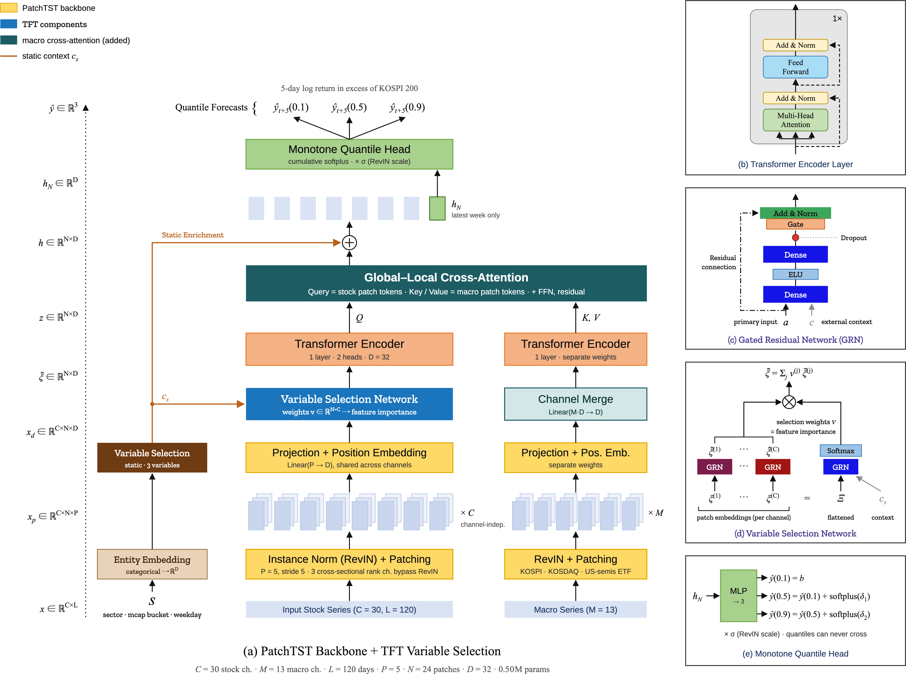
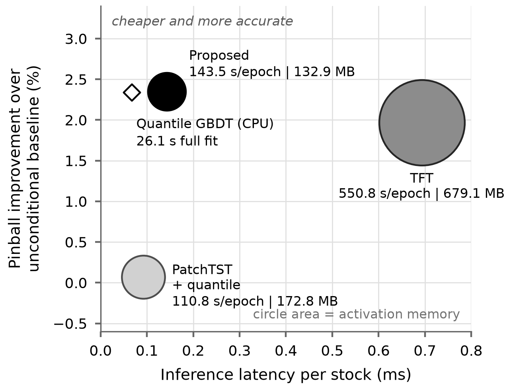

<!--
KIPS Transactions on Software and Data Engineering (KTSDE) 투고 원고
양식 출처: docs/kips/Submission_Format_KTSDE.hwp (조판값은 그 파일에서 실측)
언어: 국문 본문. 규정 2.1 에 따라 제목·저자·소속·초록·키워드·표·그림·감사의 글·
참고문헌은 영문으로 작성한다.
1쪽 구성은 실제 게재논문(정보처리학회논문지 제13권 제1호)을 따랐다.
저자 정보는 AUTHORS 표시 구간에 모아 두었고, 심사용 원고에서는 자동으로 빠진다.
⚠️ hwp 최종본 작업 시: 식 (1)~(6)이 여기서는 일반 텍스트다. 게재본은 모두 수식 개체를
쓰므로 hwp 수식 편집기로 다시 입력할 것.
-->

# A Lightweight Quantile Forecasting Model for Stock Returns with Abstention

<!-- 제목 74자. 양식 영문 지침에는 "A manuscript title should be no more than 40
characters in length." 가 있으나, docs/kips/samples/ 의 게재본 5편 영문 제목이 62~103자다
(전력수요 80 · 비디오 보간 80 · e-러닝 103 · 로봇팔 62). 문서에는 있고 실무에서는 지켜지지
않는 규정으로 보여 게재본 관행과 국문 제목과의 대응을 택했다. 사무국 문의 시 함께 확인할 것. -->

<!-- AUTHORS:BEGIN -->
Seongjun Park†⋅Jimin Kim†⋅Ohjae Kwon†⋅Haeol Song†⋅Jeongil Seo††⋅Juhan Yoo†††
<!-- AUTHORS:END -->

## ABSTRACT

Stock forecasting has long been studied for investment and risk management, yet most forecasting
models give a single value, which leaves no way to judge how far that forecast can be trusted. In
practice, an investor needs to weigh uncertainty alongside the forecast and know when to hold off. The
Temporal Fusion Transformer (TFT) also forecasts uncertainty, but it is computationally expensive, while
lightweight patch-based transformers produce only a single value. This paper proposes a lightweight
model that adds a quantile head to a patch-based transformer and merges the input channels into one
before the encoder so that the encoder runs only once, together with an abstention rule that withholds a decision when the prediction
interval is wider than usual. On daily data for 201 KOSPI 200 stocks since 2015, the proposed model had
a lower forecast error than TFT in all five repeated runs, while training 3.8 times and running
inference 4.8 times faster. Abstentions concentrated in volatile periods, and the withheld forecasts
carried about 1.5 times the error of those acted on, separating large errors better than a simple rule
based on recent volatility alone. Section 6 discusses the limitations of the evaluation design.

<!-- 196 단어 (공백 분리 기준; 제한 300). 한 문단, 표·참고문헌 번호 없음 -->

**Keywords :** Stock Return Forecasting, Patch-Based Transformer, Quantile Regression,
Forecast Uncertainty, Abstention

## 판단 보류가 가능한 경량 주가 수익률 분위 예측 모형

<!-- AUTHORS:BEGIN -->
박 성 준†⋅김 지 민†⋅권 오 재†⋅송 하 얼†⋅서 정 일††⋅유 주 한†††
<!-- AUTHORS:END -->

### 요     약

주가 예측은 투자와 위험관리 등 여러 분야에서 꾸준히 연구되고 있으나, 대부분의 예측 모형은 하나의 예측값만
제공하여 그 예측을 얼마나 신뢰할 수 있는지 판단하기 어렵다. 실제 투자에서는 예측값과 함께 불확실성을 고려하여
판단을 보류해야 할 시점을 알 수 있어야 한다. 불확실성을 함께 예측하는 모형으로 Temporal Fusion
Transformer(TFT)가 있으나 계산 비용이 크고, 계산이 가벼운 패치 기반 트랜스포머는 하나의 예측값만 제공한다.
이에 본 논문에서는 패치 기반 트랜스포머에 분위 예측 헤드를 달고 입력 채널을 인코더 앞에서 하나로 합쳐 인코더를
한 번만 실행하는 경량 모형을 제안하고,
예측 구간이 평소보다 넓을 때 판단을 보류하는 기권 규칙을 함께 적용한다. 2015년 이후 코스피200 구성종목
201개의 일별 자료로 실험한 결과, 제안 모형은 다섯 번의 반복 실험 모두에서 TFT보다 낮은 예측 오차를 보이면서
학습은 3.8배, 추론은 4.8배 빨랐다. 판단 보류는 변동성이 큰 시기에 집중되었으며, 보류된 예측의 오차는 실행된
예측의 약 1.5배였다. 이는 최근 변동성만 보고 보류하는 단순 규칙보다 큰 오차를 더 잘 걸러낸 결과이다. 평가
설계상의 한계는 6장에서 논의한다.

**키워드 :** 주가 수익률 예측, 패치 기반 트랜스포머, 분위회귀, 예측 불확실성, 기권

<!-- AUTHORS:BEGIN -->
† 비 회 원 : 동아대학교 컴퓨터공학과 학부생

†† 정 회 원 : 동아대학교 컴퓨터공학과 부교수

††† 정 회 원 : 동아대학교 컴퓨터공학과 조교수

Manuscript Received :

First Revision :

Accepted :

* Corresponding Authors : Jeongil Seo(jeongilseo@dau.ac.kr), Juhan Yoo(unchinto@dau.ac.kr)
<!-- AUTHORS:END -->

## 1. 서  론

주가 예측은 투자, 위험관리, 자산배분 등 여러 분야에서 꾸준히 연구되는 주제이다. 그러나 주가는 잡음이 크고
시장 상황에 따라 성격이 바뀌기 때문에, 어떤 모형도 모든 시점에서 정확할 수는 없다. 그렇다면 예측 모형에는
정확한 답을 내는 능력만큼 "지금은 확신할 수 없다"고 말하는 능력도 필요하다. 본 연구는 이 두 번째 능력에
주목한다.

금융 시계열에 딥러닝을 적용한 연구는 장단기기억 신경망과 합성곱 구조를 거쳐 트랜스포머 계열로 확장되며
폭넓게 축적되어 왔다[1]. 국내에서도 해외지수와 투자자 수급을 입력으로 삼은 등락 예측이 보고되었다[2].
그러나 이들 연구는 대부분 점 예측의 정확도 개선에 초점을 두며, 예측의 불확실성이나 운용 비용은 함께
다루지 않는다.

본 연구는 먼저 두 가지 운용 요구사항을 정의하고, 이를 충족하는 구조를 설계하였다. 첫째는 기권이다. 시스템은
"오를 것인가 내릴 것인가"뿐 아니라 "지금 판단해도 되는가"를 말할 수 있어야 하며, 이는 점 추정으로 정의할 수
없고 예측 분포를 요구한다. 둘째는 계산 비용이다. 201종목을 매일 평가하려면 종목당 추론이 싸야 하고, 실질적
독립 사건이 적은 자료라 모형을 키울 수도 없다. 분위 예측을 제공하는 Temporal Fusion Transformer(TFT)는 모든
시점에서 어텐션을 수행하므로 이 제약과 충돌한다.

두 요구사항은 각각 다른 구성요소를 필요로 한다. 기권에는 분위 헤드와 핀볼 손실이, 비용에는 패치 토큰화와
채널 축을 인코더 앞에서 하나로 모으는 장치가 필요하다. 이 장치는 TFT의 변수선택망으로 구현하되 더 단순한
선형 합치기와 비교한다. PatchTST를 그대로
쓰면 첫째 요구를, TFT를 그대로 쓰면 둘째 요구를 충족하지 못한다. 따라서 본 연구가 답하는 질문은 두 가지이다.
(1) 두 구성요소를 결합한 구조의 분위 정확도와 계산 비용은 두 원본과 어떻게 비교되는가. (2) 예측 구간이
변동성에 반응하여 기권이 실제로 오차가 큰 예측을 걸러내는가.

이하 2장에서 관련 연구를 정리하고, 3장에서 요구사항으로부터 제안 구조를 도출하며, 4장에서 실험 설계를,
5장에서 정확도·비용·기권 행태의 결과를 제시하고 6장에서 결론과 한계를 정리한다.

## 2. 관련 연구

### 2.1 패치 기반 시계열 트랜스포머

원래의 트랜스포머[3]는 모든 시점에서 어텐션을 수행하므로 비용이 입력 길이의 제곱에 비례한다. 희소 어텐션[4]과
계열 분해[5]로 이를 줄이려는 구조들이 제안되었으나, 단순한 선형 모형이 이들을 상회한다는 보고[6]도 있다.
PatchTST[7]는 시계열을 시점이 아니라 구간(패치) 단위로 토큰화하고 다변량 입력을 채널 독립으로 처리하여,
길이 *L*의 입력을 ⌈*L*/*S*⌉개 토큰으로 축약하고 채널 수에 선형으로 확장된다. 본 연구는 120일 입력을 패치
길이 5(1거래주)·스트라이드 5로 24개 토큰으로 축약하였다. 그러나 원 구조의 출력은 점 예측이므로 1장의 첫째 요구사항을
충족하지 못한다. 또한 채널 독립을 끝까지 유지하면 인코더가 채널 수만큼 반복 실행되어 둘째 요구사항과
충돌한다.

### 2.2 분위 예측과 변수선택 구조

TFT[8]는 변수선택망으로 입력 채널별 소프트맥스 게이트를 학습하고, 게이트 잔차 신경망(gated residual
network, GRN)으로 채널별 변환을 수행하며, 정적 공변량을 문맥 벡터로 부호화하고 복수의 분위를 동시에
산출한다. 본 연구는 이 가운데 분위 헤드를 채택하고 변수선택망은 채널 축약의 한 구현으로 비교하였으며,
시점 단위 연산 구조는 버렸다. 변수선택망을 쓰는 이유는 중요도 해석이 아니라, 채널 축을 소프트맥스 가중합으로
하나로 줄여 인코더 실행 횟수를 1회로 만드는 데 있다. 국내에서도 TFT를 다지평
예측에 적용한 연구[9]와 트랜스포머를 시계열 특성에 맞추어 변형한 연구[10]가 보고되었다.

### 2.3 분포 이동 정규화와 분위 회귀

RevIN(reversible instance normalization)[11]은 입력 윈도우별 인스턴스 정규화를 적용하고 출력에서 역변환한다. 종목과 시대에 따라 가격 수준의
의미가 달라지는 자료에서는 선택이 아닌 필수 요소이다. 본 연구는 이를 선별적으로 적용하였다. 횡단면 순위 채널은 정보가 전적으로
수준에 담겨 있어 윈도우 내 표준화가 그 정보를 소거하기 때문이다.

분위회귀[12]를 신경망 출력에 적용한 것이 핀볼 손실이며, 분위 *τ*에 대하여 식 (1)과 같이 정의된다.

&nbsp;&nbsp;&nbsp;&nbsp;L(*τ*; *y*, *ŷ*) = max[ *τ*(*y* − *ŷ*), (*τ* − 1)(*y* − *ŷ*) ]&nbsp;&nbsp;&nbsp;&nbsp;(1)

본 연구는 *τ* ∈ {0.1, 0.5, 0.9}를 동시에 학습한다. 분위 예측은 불확실성을 예측 결과 자체로 산출하므로,
앙상블 분산 없이 기권 규칙을 정의할 수 있다. 분위 예측의 구간이 명목 수준을 지키는지는 별도 문제이며
등각예측을 분위회귀에 결합한 교정 방법이 제안되어 있다[13]. 본 연구의 교정 상태는 6장에 밝힌다.

### 2.4 기준 모형과 본 연구의 위치

1장에서 언급한 금융 시계열 딥러닝 연구[1] 가운데, 장단기기억 신경망으로 미국 주식의 방향을 예측한
연구[14]와 다수의 머신러닝 기법을 자산가격 결정에 적용한 연구[15]가 대표적이다. 국내에서는 해외지수와
투자자별 매매 동향을 입력으로 삼은 등락 예측[2], 가중 손실 함수를 적용한 순환 합성곱 구조[16]가 보고되었다.
본 연구는 [2]와 마찬가지로 해외지수와 투자자 수급을 입력에 포함하되, 예측을 점이 아니라 분포로 산출한다는
점이 다르다.

잘 조정된 단순 기준모형과의 비교가 부재하다는 점은 이 분야 문헌의 공통 약점이므로, 본 연구는 동일 조건의
그래디언트 부스팅 기준모형을 함께 측정하여 5장에 보고한다.

## 3. 연구 방법

### 3.1 요구사항으로부터의 구조 도출

본 연구의 구성요소는 모두 <Table 1>의 좌측 요구사항으로부터 역산되었다.

Table 1. Requirements and corresponding components

| Requirement | Required property | Part chosen |
|---|---|---|
| Abstention | A distribution, not a point: q90 - q10 must exist | Quantile head, pinball loss |
| Cost: 120-day lookback x 201 stocks, daily | Sequence-length reduction | Patch tokenization (120 to 24) |
| Cost: channel-independent encoding repeats the encoder | Channel-axis reduction before the encoder | TFT variable selection network (vs. linear merge, Sec. 5.4) |
| Scale differs by stock and era | Non-stationary normalization | RevIN, with channel exceptions |
| Local equities track global macro | Exogenous sequence injection | Cross-attention (this work) |

### 3.2 제안 구조

제안 모형의 전체 구조는 (Fig. 1)과 같다. 입력은 세 경로로 구성된다. 종목 동적 변수(30채널 × 120일), 매크로
시퀀스(13채널), 정적 범주형 변수 3종이다. 정적 임베딩은 문맥 벡터를 형성하여 변수선택을 조건화하고,
크로스어텐션 이후 다시 더해진다. 헤드에는 마지막 패치 토큰, 즉 가장 최근 1주의 표현만이 전달된다.

Fig. 1. Architecture of the proposed model (a) with component detail (b-e). Colors mark
the PatchTST lineage (yellow), the TFT components (blue), the macro cross-attention added
in this work (teal) and the static context path (orange). The variable selection network and the
cross-attention are design options; removing either did not change the results (Sec. 5.4).

### 3.3 결합 과정의 설계 결정

아래 1)과 2)는 구조의 필수 요소가 아니라 비교 검토한 설계 선택지이며, 각각의 기여는 5.4절의 제거 실험으로
확인한다. 3)은 기권 규칙이 의존하는 구조적 요건이다.

#### 1) 변수선택망의 역할과 배치

패치 임베딩은 각 채널을 독립적으로 24개 토큰으로 변환한다. 채널 축을 줄이는 가장 싼 방법은 선형 합치기이며
매크로 경로에는 그 방식을 썼으나, 종목 채널에는 변수선택망을 두었다. 소프트맥스 게이트가 정적 문맥으로
조건화되어 섹터와 시가총액 구간에 따라 다른 가중을 주기 때문이다. 변수선택망은 그 게이트를 채널 축에
적용한다(식 2, 3).

&nbsp;&nbsp;&nbsp;&nbsp;*v*_{n} = softmax( GRN( [ flat(*E*_{n}) ; *c*_{s} ] ) ) ∈ ℝ^{C},&nbsp;&nbsp; *n* = 1, …, *N*&nbsp;&nbsp;&nbsp;&nbsp;(2)

&nbsp;&nbsp;&nbsp;&nbsp;*Z*_{n} = Σ_{i} *v*_{n,i} · GRN_{i}(*E*_{n,i})&nbsp;&nbsp;&nbsp;&nbsp;(3)

변수선택망을 인코더 뒤에 두면 인코더가 채널 수만큼 반복 실행되는 반면, 앞에 두면 채널이 먼저 하나로
축약되어 1회만 실행된다.
패치마다 산출되는 *v* ∈ ℝ^{N×C}는 각 채널의 사용 비중으로 남으나 본 연구는 이 값을 매매 근거로 제시하지 않는다. 종목 채널까지 선형
합치기로 바꾼 변형은 모수가 0.12M으로 줄면서도 정확도와 보류 행태가 같았다(5.4절). 인코더 앞에서 채널을
하나로 합치는 것이 비용 절감의 원인이며, 게이트는 그 이상의 정확도를 더하지 않았다.

#### 2) 매크로 크로스어텐션의 방향

매크로 지표를 주입하는 크로스어텐션 모듈은 본 연구에서 직접 설계하였다. 외생변수를 어텐션으로 주입하는
발상 자체는 새롭지 않다. TimeXer[17]가 같은 문제를 다루었으며, 외생 변수를 변수 단위 토큰으로 요약해 내생
패치 토큰과 교차시킨다. 본 연구의 모듈은 매크로 시퀀스를 패치 단위로 유지한 채 키와 값으로 둔다는 점이
다르다. 종목 표현을 질의로, 매크로 부호화를 키·값으로 설정하였다(식 4).

&nbsp;&nbsp;&nbsp;&nbsp;CrossAttn(*Z*, *H*_{m}) = softmax[ (*Z W*_{Q})(*H*_{m} *W*_{K})^{T} ∕ √*d*_{k} ] (*H*_{m} *W*_{V})&nbsp;&nbsp;&nbsp;&nbsp;(4)

매크로를 질의로 두면 출력이 매크로 시퀀스의 형상을 따르게 되어 종목별 예측이 산출되지 않으므로, 방향을
반대로 고정하였다. 매크로 경로에는 변수선택망을 두지 않고 13채널을 하나로 합치는 선형 변환을 썼다. 채널별로 부호화하면
비용이 13배 증가하는 반면, 매크로는 크로스어텐션의 키와 값으로만 쓰이므로 채널별 가중이 필요하지 않다. 다만 이 모듈의 정확도
기여는 확인되지 않았다(5.4절).

#### 3) 분위 단조성의 구조적 보장과 헤드 초기화

분위 교차를 손실 벌점이 아니라 누적 소프트플러스 구조로 원천 차단하였다(식 5).

&nbsp;&nbsp;&nbsp;&nbsp;*q*_{10} = *o*_{1},&nbsp;&nbsp; *q*_{50} = *q*_{10} + softplus(*o*_{2}),&nbsp;&nbsp; *q*_{90} = *q*_{50} + softplus(*o*_{3})&nbsp;&nbsp;&nbsp;&nbsp;(5)

교차가 발생하면 기권 폭이 음수가 되어 하위 규칙 전체가 무효화되므로 구조적 보장이 필요하다. 5.1절의 세 트랜스포머 모형
모두 실측 교차율은 0.000이었다.

헤드의 초기화도 성능에 영향을 주었다. 기본 초기화에서는 softplus(0) = 0.693이라 초기 구간 폭이 목표 분포와
어긋난 지점에 놓여 기준선에 미달하므로, 최종층 편향을 학습자료의 무조건부 분위수로 설정하여 해소하였다.

### 3.4 최종 설정

<Table 2>는 이후 모든 실험에 사용한 설정이다. 정규화는 2.3절에서 기술한 방식을 따른다.

Table 2. Final model configuration

| Item | Value |
|---|---|
| Lookback / patch / stride | 120 / 5 / 5, giving 24 tokens |
| d_model / heads / layers / d_ff / dropout | 32 / 2 / 1 / 64 / 0.5 |
| Quantiles | 0.1, 0.5, 0.9 |
| Dynamic / macro / static inputs | 30 channels / 13 channels / 3 categoricals |
| Normalization | RevIN, applied selectively by channel |
| Parameters | 0.50M |

## 4. 자료와 실험 설계

### 4.1 자료

분석 자료는 코스피200 구성종목 201개의 2015년 1월 2일부터 2026년 10월 16일까지 일별 자료 519,617행이며,
종목당 최대 2,892거래일이다. 지수와
투자자 수급 계열을 포함해 모두 키움증권 Open API로 수집하였다. 거래정지일은 거래량 0과 시가=고가=저가=종가로
입력되는데, 제거하지 않으면 허위의 0 수익률이 생겨 변동성 추정을 왜곡하므로 지표 산출 이전에 제거하였다.
종목별 거래일이 크게 상이하다. 가장 짧은 종목은 35거래일뿐이어서 201종목이 모두 존재하는 공통 달력은
35일로 줄어들고, 이를 강제하면 전체 행의 98.6%가 소실된다. 따라서 윈도우는
각 종목의 자기 행 위에서 구성하였다. 모형과 평가 코드는 교신저자에게 요청하면 제공하며, 원자료는 증권사 API 이용
약관상 재배포할 수 없다.

### 4.2 변수와 목표변수

<Table 3>은 입력 변수의 구성이다. 동적 30채널 가운데 기술적 지표 8채널은 수렴·발산 지표(3), 상대강도지수,
상품채널지수, 볼린저 밴드(2), 실질변동폭(ATR)이다.

Table 3. Input channels

| Group | Channels | n |
|---|---|---|
| Dynamic (stock) | returns and momentum (5), trading activity (4), moving-average gaps (3), technical indicators (8), index-relative (6), investor flows (4) | 30 |
| Macro sequences | KOSPI and KOSDAQ derivatives, overseas index exchange-traded funds | 13 |
| Static categoricals | sector, market-cap bucket, weekday | 3 |

정적 범주형 세 개는 섹터, 시가총액 구간, 요일이다. 시가총액 구간은 학습구간 종료일의 값으로 고정하였고,
요일은 사전 알려진 공변량이나 구현에서는 윈도우 마지막 날의 값을 정적 입력으로 넣었다.

가격 수준은 직접 사용하지 않는다. 이동평균은 종가 대비 괴리율로, 수렴·발산 지표와 ATR은 종가로 나누어,
유계 지표는 재척도하여 입력한다. 목표변수는 코스피200 대비 초과분으로 정의한 5일 누적 로그수익률이다(식 6).

&nbsp;&nbsp;&nbsp;&nbsp;*y*_{t} = Σ_{k=1..5} *r*_{t+k} − Σ_{k=1..5} *r*^{index}_{t+k}&nbsp;&nbsp;&nbsp;&nbsp;(6)

### 4.3 분할과 기준선

분할은 종목이 아니라 날짜 기준 전역 분할이다. 2022년까지 학습, 2023년 검증, 2024년 이후 검정이며, 목표가
5일 앞을 보므로 각 경계에 5일 격리구간을 둔다. 정규화 통계는 학습 구간 행에서만 추정한다.

윈도우는 120일 룩백이 해당 구간 안에 온전히 들어갈 때만 생성된다. 입력이 앞 구간에 걸치는 것 자체는 5일
격리구간이 목표값 중첩을 막으므로 누수가 아니나, 그 경우 검증 표본의 입력 대부분이 학습에서 이미 관측된 행이
되어 암기가 검증 성능을 부풀릴 여지가 남는다. 본 연구는 보수적으로 룩백 전체를 구간 안에 넣었고, 그 대가로
각 구간의 처음 120거래일이 소모되어 검증 표본이 122거래일로 줄었다. 검증 표본은 2023년 7월 3일부터
12월 28일까지 122거래일·190종목·23,086건, 검정 표본은 2024년 7월 3일부터 2026년 10월 8일까지
550거래일·198종목·106,490건이다. 자료는 2026년 10월 16일 수집분으로 동결하였고, 파일 해시와 구간별 윈도우
수를 기록하여 이후 모든 수치를 같은 표본에서 산출하였다.

인접 표본은 120일 중 119일의 입력과 5일 중 4일의 목표를 공유하므로 명목 학습 행 264,653건의 실질 규모는
훨씬 작다. 이 때문에 모수를 늘리면 1~2회차에 과적합되었고(이전 설정 146종목·17채널에서의 탐색), 탐색 끝에 0.50M으로 고정하였다.

모든 실험은 학습 자료의 무조건부 분위수, 즉 입력을 무시하고 세 상수를 출력하는 예측기를 기준선으로 평가한다.
이를 상회하지 못하면 초매개변수 조정 문제가 아니라 변수·목표 설계의 실패로 간주한다.

### 4.4 기권 규칙

비교하는 모든 모형에 동일한 규칙을 적용한다. 예측 구간의 폭이 최근 분포의 일정 분위를 넘으면 기권한다.
'최근 분포'는 판단일부터 거슬러 달력 90일, 거래일로는 약 60일 안에 들어온 폭을 모은 것이며, 종목별로 나누지
않고 전 종목을 합친 분포다. 구간 전체의 폭 분포를 쓰면 뒤쪽 날짜의 폭이 앞쪽 날짜의 기권 판단에 흘러들어
미래 정보가 유입되기 때문이고, 모의투자에서 실제로 쓰는 방식과도 같다.

## 5. 실험 결과

### 5.1 동일조건 정확도 비교

세 모형은 자료·분할·학습절차·조기종료 규칙을 공유하며 기준선도 0.012175로 동일하게 산출되어 통제가
작동하였음을 수치로 확인할 수 있다. 두 가지 제약을 밝힌다. PatchTST 계열 대조군은 원 구조에 해당 개념이
없어 매크로와 정적 공변량을 입력받지 못하므로, 본 비교는 원본을 그대로 쓸 때 무엇을 포기하게 되는가의
비교이다. 초매개변수는 제안 모형에 맞추어 조정된 값을 대조군에 동일하게 적용하였으므로 대조군의
최적값이 아니다.

Table 4. Forecast accuracy (three-quantile pinball loss, mean over five seeds 42-46 with the standard deviation). All transformer rows were trained on Kaggle GPUs under identical mixed-precision settings and evaluated on one device. The quantile gradient-boosting row is a single run, since the fit has no random component. The unconditional-quantile baseline is 0.012175 on validation and 0.018754 on test. With all three models in single precision, one run each, the test improvements are +5.25% for the proposed model, +3.30% for TFT and +2.25% for PatchTST with the quantile head, so the ordering is unchanged. The original point-forecast PatchTST is left out: scored as three identical quantiles it falls 47.79% below the baseline, which reflects the loss function rather than a comparison

| Model | Params | Validation | vs baseline | Test | vs baseline | Best epoch |
|---|---|---|---|---|---|---|
| PatchTST + quantile head | 0.035M | 0.012166 ± 0.000022 | +0.07% | 0.018686 ± 0.000130 | +0.36% | 1-5 |
| TFT, original | 0.687M | 0.011935 ± 0.000020 | +1.97% | 0.018325 ± 0.000091 | +2.28% | 1-2 |
| Quantile GBDT | 375 trees | 0.011890 | +2.34% | 0.018107 | +3.45% | - |
| **Ours (PatchTST x TFT)** | 0.500M | 0.011889 ± 0.000012 | +2.35% | **0.017826 ± 0.000059** | **+4.95%** | 2-10 |

제안 모형은 두 구간 모두에서 TFT 원본보다 손실이 낮았고, 다섯 시드를 짝지은 열 번의 비교 전부에서 그러하였다
(부호검정 *p* = 0.031 단측, 두 구간 동일). 검증구간의 격차는 핀볼 손실 0.000046으로 기준선 대비
개선폭의 16%에 그치므로 우위가 아니라 대등하거나 근소하게 낫다는 수준으로 해석한다. 조기종료와 최적 회차
선택에 쓰이지 않은 검정구간에서는 격차가 0.000499로 벌어지며 다섯 시드의 범위가 겹치지 않는다
(0.017739~0.017895 대 0.018205~0.018407). 평균 차이에 대한 Welch 검정은 검증 *t* = 4.47(*p* = 0.004),
검정 *t* = 10.33(*p* < 0.001)이다. 같은 표본의 날짜별 손실 계열에 Diebold-Mariano 검정(Newey-West 4시차,
Harvey-Leybourne-Newbold 보정)을 적용하면 550거래일의 검정구간에서는 다섯 시드 모두 유의하나
(*p* = 0.022, 0.001, 0.009, 0.003, < 0.001) 122거래일의 검증구간에서는 다섯 시드 모두 유의하지 않다
(*p* = 0.16~0.56) — 날짜를 표본으로 보는 검정이므로 짧은 구간에서는 검정력이 약하다. 분위 헤드만 부착한
PatchTST는 검증구간 +0.07%, 검정구간 +0.36%로 상수 예측을 간신히 상회하는 데 그쳤고, 다섯 시드 가운데
네 시드는 첫 회차에서 최적값에 도달하였다. 격차가 검정구간에서 벌어지는 이유의 하나는 학습 곡선이다. TFT는 다섯 시드 모두
1~2회차에서 최적값에 도달한 뒤 과적합으로 돌아섰고, 제안 모형의 최적 회차는 2~10회차에 분포하였다. 다만
격차의 일부는 수치 정밀도 설정에서 오며, 단정밀도로 맞추면 줄어든다(<Table 4> 캡션).

트리 계열 기준모형으로 분위 손실을 쓰는 히스토그램 그래디언트 부스팅(LightGBM[18]의 방식을 따른
scikit-learn 구현)을 같은 분할과 같은 윈도우 표본에서 평가하였다. 입력은 동적 30채널의 당일 값과 1·5·20일
시차, 매크로 13채널, 정적 범주형 3종의 136개이고, 분위마다 모형을 하나씩 두어 검증구간 손실로 트리 수를
정하였다(75·25·275개). 검증구간 손실은 제안 모형과 같았고(0.011890 대 0.011889), 검정구간 손실은 TFT
원본보다 작고 제안 모형보다 컸다. 제안 모형의 다섯 시드는 모두 이 값보다 낮았다(최대 0.017895 대 0.018107).

### 5.2 계산 비용

Table 5. Computational cost measured on one device (Mac MPS, batch 64, 120-day input, 201 stocks). Seconds per epoch is the median training-step time over 40 batches times the 4,135 batches that one epoch takes over the 264,653 training windows of Section 4.3. The universe pass is the median of 21 forward passes over 201 stocks, and latency per stock is that value divided by 201 rather than an independent measurement. Activation is the device allocation added by a forward pass that retains the backward graph. Two independent runs agreed within 0.8%

| Model | s / epoch | Latency / stock | Universe pass | Activation | Param memory |
|---|---|---|---|---|---|
| PatchTST (+ quantile head) | 110.8 | 0.092 ms | 18.6 ms | 172.8 MB | 0.14 MB |
| TFT, original | 550.8 | 0.693 ms | 139.4 ms | 679.1 MB | 2.75 MB |
| Ours | 143.5 | 0.143 ms | 28.7 ms | 132.9 MB | 2.00 MB |

대등한 정확도에서 제안 모형은 TFT 원본 대비 학습 3.8배, 종목당 추론 4.8배, 활성값 메모리 5.1배의 절감을
보였다. 패치 토큰화가 어텐션 대상 시퀀스를 120에서 24로 줄이고 인코더 앞의 채널 축약이 채널 반복을
제거한 결과이며, 모수 1.4배 차이는 부차적이다. 같은 배율은 장비와 배치가 다른 조건에서도 재현된다 —
<Table 4>를 얻은 캐글 GPU(배치 256, 혼합정밀도)에서 제안 모형 41.8초/epoch, TFT 원본 157.1초/epoch였다.

(Fig. 2)는 <Table 4>의 검증구간 정확도와 <Table 5>의 비용을 한 평면에 놓은 것이다. 지연시간만 보면 분위
헤드 모형이 더 왼쪽에 있으나, 정확도와 비용을 함께 보면 제안 모형이 파레토 전선 위에 있다.

Fig. 2. Forecast accuracy against inference cost. The vertical axis is the pinball
improvement over the unconditional-quantile baseline on validation (<Table 4>), the
horizontal axis is per-stock inference latency, and the marker area is activation memory
for a 120-day input (<Table 5>). The original point-forecast PatchTST is omitted because
its pinball loss falls far below the plotted range.

### 5.3 기권 행태

네 분위 모형에 4.4절의 동일한 기권 규칙을 적용하고 검정구간 전체에서 집계하였다. 점 예측 모형은 임계할
폭이 없어 기권이 정의되지 않으므로 제외하였다.

Table 6. Abstention on the test split (550 days, 106,490 windows), mean over five seeds with the standard deviation for TFT and the proposed model and a single run for the quantile GBDT. The threshold is the 95th percentile of the width distribution over the trailing 90 calendar days, pooled across all stocks; Q1 and Q4 are the lowest and highest quartiles of realized volatility at decision time. Pinball loss is reported separately for abstained and retained candidates

| Model | Abstain | Q1 | Q4 | Pinball, abstained | Pinball, retained |
|---|---|---|---|---|---|
| PatchTST + quantile | 5.24 ± 0.32% | 3.45 ± 2.04% | 8.02 ± 2.75% | 0.02127 ± 0.00171 | 0.01855 ± 0.00022 |
| Quantile GBDT | 5.36% | 0.00% | 17.04% | 0.02622 | 0.01765 |
| TFT, original | 5.28 ± 0.13% | 0.00 ± 0.00% | 16.71 ± 0.41% | 0.02584 ± 0.00104 | 0.01791 ± 0.00014 |
| **Ours** | 5.91 ± 0.11% | 0.21 ± 0.05% | **20.07 ± 0.71%** | 0.02612 ± 0.00040 | **0.01730 ± 0.00005** |

<Table 6>은 기권 요구사항이 규칙이 아니라 구조에 의해 충족되었음을 보여준다. 네 행의 기권 규칙은 동일하며
예측 분포만 다르다. 분위 헤드를 부착하면 기권이 작동하기 시작하고, 변수선택·정적 문맥·매크로 입력이
더해지면 최상위 변동성 분위의 기권율이 20.07%인 반면 최하위 분위는 0.21%에 머물러(셋 중 하나를 빼도 유지된다, 5.4절) 기권이 고변동 구간에
집중된다. 다만 예측 폭과 실현 변동의 상관 자체는 TFT 원본이 더 높았다(0.186 대 0.170). 기권이 고변동
구간에 더 몰리는 것과 폭이 변동을 더 잘 따라가는 것은 별개의 성질이다. 보류된 판단은 실제로 더 나빴다. 제안 모형이 기권한 예측의 핀볼 손실은 남긴 예측의
1.510 ± 0.023배이며, 날짜 단위로 짝지은 손실차의 *t* 값은 19.41 ± 1.02이다. 반면 중앙값 부호의 방향
적중률은 기권 0.52 대 유지 0.52로 거의 같다 — 보류된 판단은 방향을 틀리기 쉬운 판단이 아니라 오차의 크기가
큰 판단이며, 이는 기권이 폭에 걸려 있다는 설계와 일치한다.

다만 핀볼 손실은 변동성이 큰 구간에서 원래 크므로, 고변동 구간을 피하는 규칙이라면 무엇이든 이 비가 1을
넘는다. 규칙과 분위를 그대로 두고 점수만 예측 폭에서 직전 20일 실현변동성으로 바꿔 끼운 통제군과
대조하였고, 기권율 차이가 섞이지 않도록 날짜마다 두 점수의 횡단면 순위 상위 r%를 보류시켜 같은 날 같은
개수를 보류하게 맞추었다. r = 2, 5, 6, 10, 20, 30% 여섯 수준 전부에서 다섯 시드 모두 폭 기준의 비가
통제군보다 높았고(차이 최소 +0.030, 6%에서 +0.064 ± 0.029), 날짜 블록 부트스트랩 1,000회의 95%
신뢰구간도 0을 포함하지 않았다. TFT 원본은 2~6% 구간에서 시드에 따라 부호가 바뀌었고, 분위 헤드만 부착한
모형은 통제군에 미치지 못하였다. 예측 폭이 단순 변동성 지표보다 나은 보류 기준이라는 결과는 분위 헤드를
부착하는 것만으로는 생기지 않았다. 분위 GBDT의 폭도 같은 비교에서 통제군보다 나았다(6%에서 +0.071, 95%
신뢰구간 [+0.033, +0.107]). 제안 모형(+0.064 ± 0.029)과 차이가 없으므로 이 성질은 트랜스포머 구조에
고유하지 않다. 제안 모형에 남는 차이는 최상위 변동성 분위로의 집중(20.07% 대 17.04%)과 남긴 후보의
손실(0.01730 대 0.01765)이다.

기권율의 절대 수준을 정하는 임계값 분위는 검정구간을 참조하여 선택되었으므로 5.91%라는 값은 표본 밖
수치가 아니다. 다만 분위를 95에서 90, 75로 낮추면 전체 기권율이 11.71%, 28.08%로 오르는 동안 최상위
변동성 분위의 기권율도 36.22%, 68.72%로 함께 올라 분위별 집중이 유지되고, 세 분위 모두에서 최상위 분위
기권율의 모형 간 순서(제안 모형 > TFT 원본 > 분위 헤드)도 보존된다. 임계값 선택이 기권 행태에 관한 결론을
만들어낸 것은 아니다.

### 5.4 구성요소 제거

분위 헤드만 단 PatchTST와 제안 모형 사이에는 변수선택망, 정적 문맥, 매크로 크로스어텐션이 한꺼번에 더해져
있다. 개선이 어디서 오는지 가리기 위해 셋을 하나씩 제거한 변형을 같은 설정과 시드로 학습하였다. 변수선택망은
매크로 경로와 같은 선형 합치기로 바꾸었고, 매크로 제거 변형은 크로스어텐션 없이 종목 표현을 헤드로 보내며,
정적 문맥 제거 변형은 문맥 벡터를 0으로 두어 변수선택의 조건화와 결합 뒤 더하기를 함께 껐다. 초매개변수는
<Table 2> 그대로이며, 보고 지표는 실험 전에 검정구간 핀볼 손실, 최상위 변동성 분위의 기권율, 기권율 6%에서
맞춘 통제군 대비 비 차이의 셋으로 정하였다.

Table 7. Removing one component at a time (test split, mean over five seeds 42-46 with the standard deviation). The sign test counts the seeds on which the proposed model has the lower test loss. The last column is the difference between the abstained-to-retained loss ratio of the width rule and that of the trailing 20-day volatility control at a matched 6% abstention rate (Section 5.3)

| Variant | Params | Test pinball | vs baseline | Ours lower | Q4 abstain | Ratio gap at 6% |
|---|---|---|---|---|---|---|
| Ours | 0.500M | 0.017826 ± 0.000059 | +4.95% | - | 20.07 ± 0.71% | +0.064 ± 0.029 |
| VSN to linear merge | 0.117M | 0.017837 ± 0.000078 | +4.89% | 3/5 | 19.90 ± 0.18% | +0.057 ± 0.007 |
| No macro cross-attention | 0.468M | 0.017786 ± 0.000029 | +5.16% | 2/5 | 20.51 ± 0.46% | +0.080 ± 0.035 |
| No static context | 0.456M | 0.017797 ± 0.000010 | +5.10% | 1/5 | 20.18 ± 0.30% | +0.067 ± 0.021 |

세 변형 모두 세 지표에서 제안 모형과 구별되지 않았다. 검정 손실의 Welch 검정은 *p* = 0.81, 0.21, 0.33이고,
짝지은 비교에서 제안 모형이 낮은 시드는 다섯 가운데 셋, 둘, 하나였다. 기권율 6%의 통제군 비교는 열다섯
실행 가운데 열넷에서 95% 신뢰구간이 0을 포함하지 않았다. 따라서 PatchTST에 분위 헤드만 단 모형 대비 개선은
어느 한 구성요소에서 오지 않는다. 남는 설명은 둘이다. 세 변형이 공유하는 것, 즉 패치 임베딩을 인코더 앞에서
채널 축으로 합치는 구조 자체가 개선의 원인이거나, 구성요소들이 서로를 대신하여 하나를 빼도 나머지가
보완하는 경우이다. 둘 이상을 함께 제거하지 않았으므로 이 둘은 가려지지 않는다. 선형 합치기 변형은 모수가
4분의 1이면서 결과가 같았으므로, 변수선택망의 정확도상 이점은 이 자료에서 확인되지 않는다.

## 6. 결론 및 향후 연구

본 연구는 주가 예측에서 "지금 판단해도 되는가"를 함께 답하는 모형을, 매일 201종목을 평가할 수 있는 비용
안에서 만드는 것을 목표로 하였다. 계산이 가벼운 패치 기반 트랜스포머에 TFT의 분위 예측 헤드를
달고, 입력 채널을 인코더 앞에서 하나로 합쳐 인코더 실행 횟수를 1회로 줄였다. 예측 구간이 이례적으로 넓을 때
판단을 보류하는 기권 규칙도 함께 적용하였다. 코스피200 구성종목 201개의 일별 자료로 평가하여 다음 두 가지를
확인하였다.

첫째, 제안 모형은 TFT 원본보다 낮은 오차를 약 4분의 1의 비용으로 달성하였다. 다섯 번의
반복 실험을 짝지은 열 번의 비교 전부에서 제안 모형의 손실이 낮았고, 조기종료에 쓰이지 않은 검정구간에서는
날짜 단위 DM 검정도 다섯 시드 모두 유의하였다. 학습 시간은 3.8배, 종목당 추론 시간은 4.8배 짧았고,
활성값 메모리는 5.1배 적었다. 둘째, 예측 구간이 시장 변동성에 반응하여 판단 보류가 변동성이 큰 시기에
집중되었다. 보류된 예측은 실행된 예측보다 오차가 약 1.5배 컸고, 기권율을 맞춘 비교에서도 최근 변동성만
보고 보류하는 단순 규칙보다 큰 오차를 더 잘 걸러냈다. 다만 분위 GBDT도 같은 비교에서 대등한 보류 품질을
보였으므로 이 성질은 트랜스포머 구조에 고유하지 않다. 하나의 예측값만 내는 기존 패치 기반 모형으로는
이러한 판단 보류 자체를 할 수 없다.

본 연구의 평가는 평가 기간 자료가 입력 설계와 기권 기준 선택에 일부 참고되었고, 현재 시점의 구성종목으로
유니버스를 정하였으므로 완전한 사후 검증은 아니다. 또한 변수선택망, 정적 문맥, 매크로 크로스어텐션은 하나씩
제거해도 결과가 달라지지 않아, 개선이 인코더 앞 채널 축약 구조 자체에서 오는지 구성요소 간 대체에서 오는지
가리지 못하였다(5.4절). 예측 구간의 절대 포함률은 명목 80%보다 낮았고(71.6%), 검증구간에서 맞춘 CQR[13] 보정 후에도
73.9%에 그쳐 구간 자체를 신뢰구간으로 해석해서는 안 된다. 보정은 폭의 순위를 바꾸지 않으므로 기권 결과에는
영향이 없다.

본 논문의 결과는 과거 자료에 대한 평가이며 투자 권유를 의도하지 않는다. 향후 연구에서는 구성요소를 둘 이상
함께 제거하는 실험으로 개선의 출처를 가리고, 비교 이후 새로 쌓인 자료를 평가에 쓰지 않은 구간으로 두어 여러
시장 국면에서 다시 검증한다.

## References

[1] O. B. Sezer, M. U. Gudelek, and A. M. Ozbayoglu, "Financial time series forecasting with deep learning: A systematic literature review: 2005-2019," Applied Soft Computing, Vol.90, 106181, 2020.

[2] T. S. Kim and S. Lee, "Deep learning-based stock fluctuation prediction according to overseas indices and trading trends," KIPS Transactions on Software and Data Engineering, Vol.10, No.9, pp.367-374, 2021.

[3] A. Vaswani, N. Shazeer, N. Parmar, J. Uszkoreit, L. Jones, A. N. Gomez, L. Kaiser, and I. Polosukhin, "Attention is all you need," in Advances in Neural Information Processing Systems, 2017, pp.5998-6008.

[4] H. Zhou, S. Zhang, J. Peng, S. Zhang, J. Li, H. Xiong, and W. Zhang, "Informer: Beyond efficient transformer for long sequence time-series forecasting," in Proceedings of the AAAI Conference on Artificial Intelligence, 2021, pp.11106-11115.

[5] H. Wu, J. Xu, J. Wang, and M. Long, "Autoformer: Decomposition transformers with auto-correlation for long-term series forecasting," in Advances in Neural Information Processing Systems, 2021, pp.22419-22430.

[6] A. Zeng, M. Chen, L. Zhang, and Q. Xu, "Are transformers effective for time series forecasting?," in Proceedings of the AAAI Conference on Artificial Intelligence, 2023, pp.11121-11128.

[7] Y. Nie, N. H. Nguyen, P. Sinthong, and J. Kalagnanam, "A time series is worth 64 words: Long-term forecasting with transformers," in Proceedings of the International Conference on Learning Representations, 2023.

[8] B. Lim, S. O. Arik, N. Loeff, and T. Pfister, "Temporal fusion transformers for interpretable multi-horizon time series forecasting," International Journal of Forecasting, Vol.37, No.4, pp.1748-1764, 2021.

[9] I. K. Kim, D. H. Kim, and J. Lee, "Temporal fusion transformers and deep learning methods for multi-horizon time series forecasting," KIPS Transactions on Software and Data Engineering, Vol.11, No.2, pp.81-86, 2022.

[10] D.-K. Kim and K. Kim, "Style-based transformer for time series forecasting," KIPS Transactions on Software and Data Engineering, Vol.10, No.12, pp.579-586, 2021.

[11] T. Kim, J. Kim, Y. Tae, C. Park, J.-H. Choi, and J. Choo, "Reversible instance normalization for accurate time-series forecasting against distribution shift," in Proceedings of the International Conference on Learning Representations, 2022.

[12] R. Koenker and G. Bassett, "Regression quantiles," Econometrica, Vol.46, No.1, pp.33-50, 1978.

[13] Y. Romano, E. Patterson, and E. J. Candes, "Conformalized quantile regression," in Advances in Neural Information Processing Systems, 2019, pp.3543-3553.

[14] T. Fischer and C. Krauss, "Deep learning with long short-term memory networks for financial market predictions," European Journal of Operational Research, Vol.270, No.2, pp.654-669, 2018.

[15] S. Gu, B. Kelly, and D. Xiu, "Empirical asset pricing via machine learning," The Review of Financial Studies, Vol.33, No.5, pp.2223-2273, 2020.

[16] H. J. Kim and Y. S. Jung, "A stock price prediction based on recurrent convolution neural network with weighted loss function," KIPS Transactions on Software and Data Engineering, Vol.8, No.3, pp.123-128, 2019.

[17] Y. Wang, H. Wu, J. Dong, G. Qin, H. Zhang, Y. Liu, Y. Qiu, J. Wang, and M. Long, "TimeXer: Empowering transformers for time series forecasting with exogenous variables," in Advances in Neural Information Processing Systems, 2024.

[18] G. Ke, Q. Meng, T. Finley, T. Wang, W. Chen, W. Ma, Q. Ye, and T.-Y. Liu, "LightGBM: A highly efficient gradient boosting decision tree," in Advances in Neural Information Processing Systems, 2017, pp.3146-3154.

<!-- AUTHORS:BEGIN -->
<!--
저자 소개 — 게재 확정 후 최종본에만 들어간다(규정 2.1). 양식 마지막 장 구성:
  이름(중고딕 11pt) / 사진 / ORCID / e-mail / 학력 / 경력 / 관심분야(신명조 8.5pt)
ORCID 는 orcid.org 에서 무료 발급. 관심분야는 게재본 관례대로 영문으로 적는다.
박성준 외 세 명은 본인이 직접 채운다 — 추정해 넣지 않았다.
사진은 게재논문 5편 중 4편이 저자 수만큼 넣었고 1편은 1인 생략 — 관례이나 절대 요건은 아닌 것으로 보인다.
-->

#### 박 성 준

https://orcid.org/0009-0004-9626-5165

e-mail : appop001@naver.com

2021년～현  재 동아대학교 컴퓨터공학과 학사과정

관심분야 : Time-Series Forecasting, Quantile Regression, Deep Learning, Algorithmic Trading

#### 김 지 민

https://orcid.org/0009-0004-4645-227X

e-mail : bckck@naver.com

2020년～현  재 동아대학교 컴퓨터공학과 학사과정

관심분야 : Deep Learning, Financial Time-Series Analysis, Uncertainty Estimation

#### 권 오 재

https://orcid.org/0009-0002-9537-5317

e-mail : rnjsdhwo4@naver.com

2021년～현  재 동아대학교 컴퓨터공학과 학사과정

관심분야 : Machine Learning, Time-Series Forecasting, Quantitative Finance

#### 송 하 얼

https://orcid.org/0009-0007-5429-4154

e-mail : haeolsong@gmail.com

2023년～현  재 동아대학교 컴퓨터공학과 학사과정

관심분야 : Deep Learning, Transformer Models, Data Analysis

#### 서 정 일

[사진]

https://orcid.org/0000-0000-0000-0000

e-mail : jeongilseo@dau.ac.kr

20○○년 ○○대학교 ○○학과(학사)

20○○년 ○○대학교 ○○학과(석·박사)

20○○년～현  재 동아대학교 컴퓨터공학과 부교수

관심분야 :

#### 유 주 한

[사진]

https://orcid.org/0000-0000-0000-0000

e-mail : unchinto@dau.ac.kr

20○○년 ○○대학교 ○○학과(학사)

20○○년 ○○대학교 ○○학과(석·박사)

20○○년～현  재 동아대학교 컴퓨터공학과 조교수

관심분야 :
<!-- AUTHORS:END -->
